English | [简体中文](README.zh-CN.md)

# egui-customplot

An embeddable Rust plotting library for scientific and engineering applications built with [`egui`](https://github.com/emilk/egui). Plot a live signal, inspect a volume or measure a control system’s response inside an existing UI. Your application owns the samples and view state.

| 3D surface · `--surfaces3d` | Filled contours · `--contours` |
| --- | --- |
| [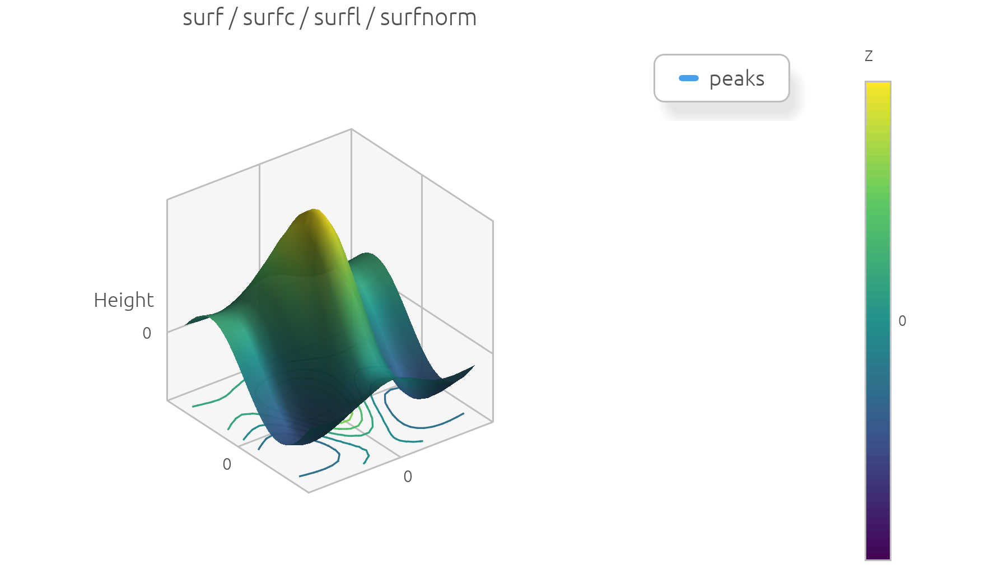](docs/images/surface.png) | [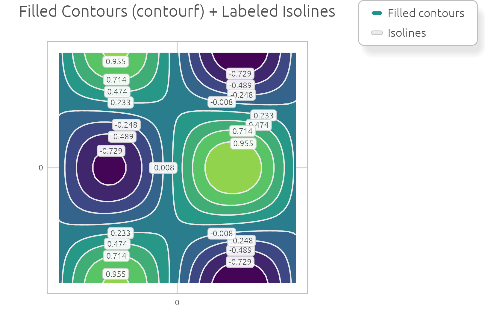](docs/images/contours.png) |
| Orbit the peaks to inspect their shape. Floor contours locate them in the plane, and the color bar gives their height. | Read a scalar field from above. Filled bands separate value ranges, and labels identify the level of each isoline. |

[Explore the illustrated guide](#illustrated-chart-guide) or [look up a plot by name](#capability-index). Version `0.1.1` adds high-resolution export, external legends, an STFT color bar, shared A/B cursors and unit-step response plots.

> **Integration and verification**
>
> The demo contains 27 interactive galleries. The `export` feature enables PNG and hybrid SVG snapshots. The `wgpu` feature accelerates supported series on the host’s device. Physical display checks on Linux, macOS and WebAssembly and long-duration resource tests are pending. 3D surface and volume rendering use the CPU.

---

## Key Capabilities

- **Core Architecture**
  - **Host-owned data (`Arc`)**: Immutable/versioned containers (`PlotData`, `GridData`, `ContourData`, `Surface3DData`, `ScalarVolume3D`, `PointCloud3DData`, etc.) stay with the host application; `PlotState` / `Plot3DState` never retain sample buffers or GPU textures.
  - **egui multi-pass idempotency**: Safe under `egui::Context::request_discard` retries — navigation, box-zoom/brushing, `AxisLink` synchronization, `PlotStream` / `FrameClock` updates, and deferred demo exports apply once per frame.
  - **Seven-domain modular layout**: Strictly organized across `axis`, `data`, `interaction`, `layout`, `model`, `render`, `widget` (+ `diagnostics`), enforced by `tests/architecture.rs` (`<= 400` lines per library source file).
- **Three-Tier Performance (`L1` / `L2` / `L3`)**
  - **L1 Zero-config smart defaults**: `PlotData::new` auto-builds a monotonic-X index (`>= 8,192` samples, 64 MiB cap); `LineSampling::Auto` & `MarkerSampling::Auto` preserve peaks and switch to exact rendering when zoomed in; `PlotState` embeds a bounded 2 MiB auto cache; raw-point picking uses 2D screen-AABB branch-and-bound pruning.
  - **L2 Explicit customization**: `LineSampling::{Auto, Exact, Visible, MinMax}`, `MarkerSampling::{Auto, Exact, PixelGrid}`, `RenderBackend::{Auto, Painter, Wgpu}`, 5-layer style inheritance (`defaults -> Theme -> inherited/Figure -> Plot -> Series`), `PlotDefaults`, `PlotCache`, `Plot::pan_limits`, dual Y, linear/log10/probit/weibull/datetime/duration/categorical axes, and self-contained PNG/SVG snapshots (`feature = "export"`).
  - **L3 10M-point live streaming & GPU**: Zero-copy `IndexedStream` (`StreamLine`), `O(1)`-sliced `UniformWaveform` (`WaveformLine`), and optional `feature = "wgpu"` (`register_wgpu`) WGSL compute + instanced rendering reusing the host `egui_wgpu::RenderState`, with automatic CPU `Painter` fallback when unavailable or exporting.

---

## Customize a plot component

In the surface gallery above, the height labels stay on the edge at minimum X and maximum Y as the camera orbits. X and Y select their own edges from the projected box. The edge endpoints are in data coordinates, so reversing X preserves the meaning of “minimum X”.

```rust
use egui_customplot::{Axis3D, AxisEdge3D, Plot3D};

let surface = Plot3D::new("surface").z_axis(
    Axis3D::new().label("Height").label_edge(AxisEdge3D::new(false, true)),
);
```

| To change | Public entry point |
| --- | --- |
| One 3D axis | Set a fixed edge with `Axis3D::label_edge`, or implement `AxisDecoration3D` to select an edge, position the labels or draw them. `ScaleMapping3D` accepts a monotone forward/inverse pair on a built-in validity domain. `CameraLens3D` supplies a projective lens with a matching picking ray. `CameraNavigation3D` maps orbit, pan and scroll gestures to the next camera pose. |
| Legend, title or color bar | Attach a `LegendComponent` or `PlotDecoration` to a Cartesian 2D, 3D or geographic plot. Polar plots also accept custom legends and titles. The component measures its space in logical points. External components get a clipped drawing area outside plot navigation. |
| A host-owned layer | Mix `PlotLayer::custom(&layer)` with native 2D layers. The layer supplies its range, paint batch and optional pick. During snapshot capture it can emit exportable shapes. In 3D submit `Layer3D::Custom` with point, polyline or triangle batches and a geometry revision for the depth cache. |
| A control-system chart | Use `BodePlot::show_with_panels` for magnitude and phase, and `panel_at` to read the actual subplot transform. `StepResponsePlot::configure_plot` and `configure_curve` expose its axes, annotations and response curve. |

[Runnable host-component tests](crates/egui-customplot/tests/host_components.rs) · [3D layout, scale and projection tests](crates/egui-customplot/tests/customization_3d.rs)

## Requirements & Cargo Features

- **Rust**: `1.95+` (Edition `2024`; tested on Rust `1.100.0` / Windows x64 / `egui 0.37.0`)
- **Cargo features (`crates/egui-customplot/Cargo.toml`)**:
  - `default = []`: Core CPU + `egui::Painter` plotting (depends only on `egui`).
  - `export`: Enables `PlotSnapshot`, `ExportOptions`, and `CaptureLimits` for PNG & hybrid-vector SVG output (`png` dependency).
  - `wgpu`: Enables `register_wgpu`, `register_wgpu_with_config`, `set_wgpu_budget`, and `WgpuPlotConfig` (`egui-wgpu`, `wgpu`, `bytemuck`).

---

## Quick Start

Add `egui-customplot` to your `Cargo.toml`:

```toml
[dependencies]
egui = "0.37.0"
egui-customplot = "0.1.1"
# Optional features:
# egui-customplot = { version = "0.1.1", features = ["export", "wgpu"] }
```

### Minimal 2D Plot

Keep sample data and `PlotState` in your application model across frames (do not rebuild `PlotData` every frame):

```rust
use egui_customplot::{Line, Plot, PlotData, PlotState};

// App initialization:
let data = PlotData::new(vec![[0.0, 0.0], [1.0, 1.0], [2.0, 0.0]]);
let mut state = PlotState::default();

// Inside your egui UI closure (`ui: &mut egui::Ui`):
Plot::new("signal")
    .height(320.0)
    .allow_scroll_zoom(true) // off by default so parent ScrollArea is not hijacked
    .allow_box_zoom(true)
    .show(ui, &mut state, &[Line::new(&data).name("Signal")]);
```

### Heterogeneous Layers (`PlotLayer`)

```rust
use egui_customplot::{Bar, BarData, Bars, ErrorBar, ErrorBarData, ErrorBars, Plot, PlotState};

let bars = BarData::new(vec![Bar::new(1.0, 2.0), Bar::new(2.0, -1.0)]);
let errors = ErrorBarData::new(vec![ErrorBar::new([1.0, 2.0]).y_error([0.2, 0.4])]);
let mut state = PlotState::default();

Plot::new("measurements").show_layers(
    ui,
    &mut state,
    &[Bars::new(&bars).into(), ErrorBars::new(&errors).into()],
);
```

See the [API & User Guide](crates/egui-customplot/docs/guide.md) or build the interactive rustdoc (`EN | 简体中文` toggle in the header/sidebar):

```sh
cargo doc --workspace --no-deps --all-features --open
```

---

## Illustrated chart guide

Each heading gives the demo preset. Run `cargo run -p customplot-demo --release --locked -- --stage15` and substitute the preset you want. Select a figure to inspect it at full resolution.

[Signals](#gallery-signals) · [Fields](#gallery-fields) · [Statistics](#gallery-statistics) · [RF and control](#gallery-control) · [Spatial data](#gallery-spatial) · [Relationships](#gallery-relationships)

<a id="gallery-signals"></a>

### Signals, samples and time

Use a line for a continuous trace, steps for a held value and stems for isolated observations. The default gallery also supports log axes for power-law data.

| Signal and observations · default gallery | Sample and hold · `--stairs` |
| --- | --- |
| [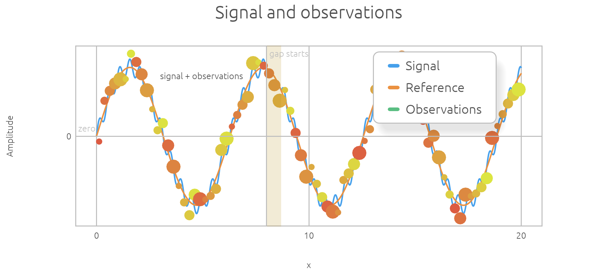](docs/images/signal.png) | [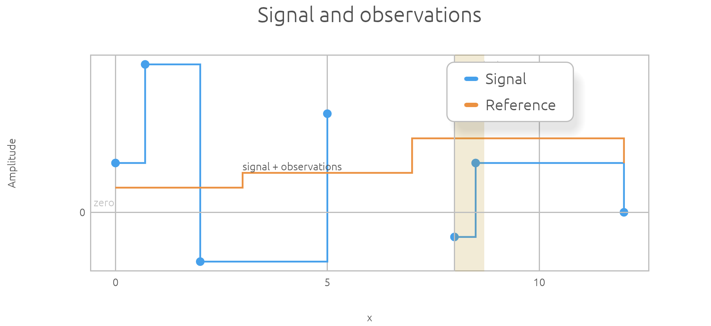](docs/images/stairs.png) |
| Overlay observations on a continuous signal and hover to inspect an original sample. | Markers show when the value changes. Horizontal segments show how long it holds. |

| Signed stems · `--stems` | Bars with uncertainty · `--statistical` |
| --- | --- |
| [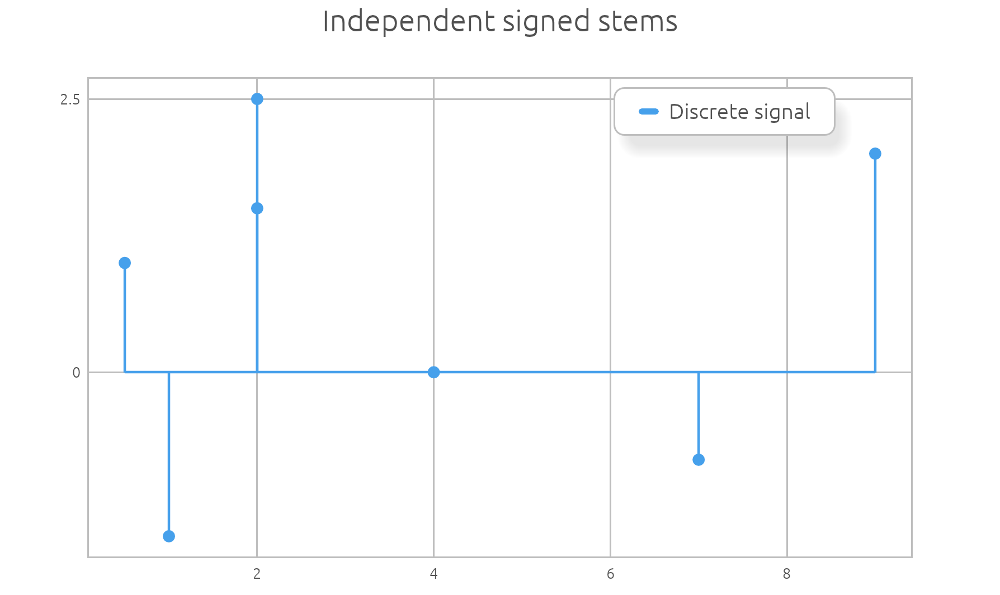](docs/images/stems.png) | [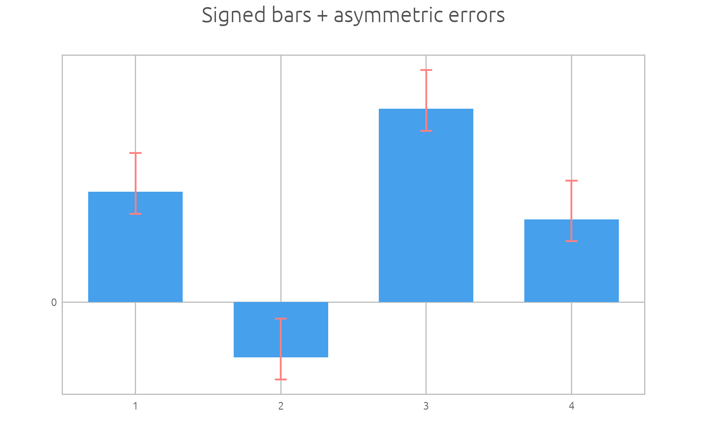](docs/images/bar-errors.png) |
| Each endpoint has its own distance and direction from the baseline. | Compare signed measurements and their asymmetric error intervals. The gallery also includes explicit-bin histograms. |

| Two units, one timeline · `--custom-axes` | Ten million samples · `--dynamic-10m` |
| --- | --- |
| [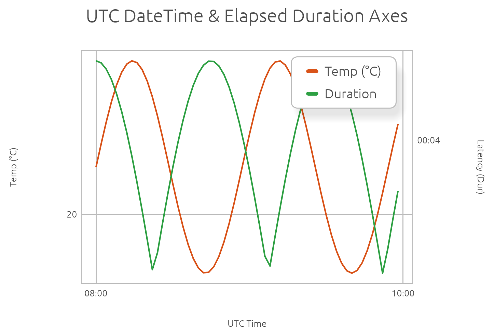](docs/images/dual-axis.png) | [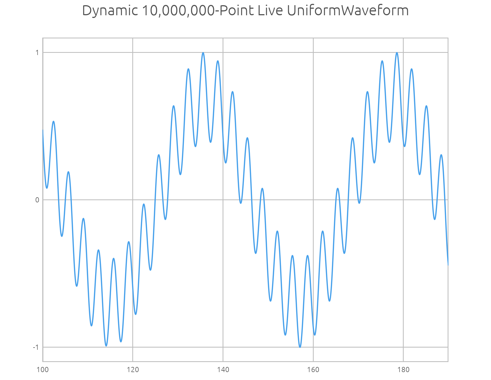](docs/images/streaming.png) |
| Read temperature on the left and duration on the right. The legend sits outside the axes. | This 90-second window shows detail from a ten-million-sample waveform. The demo updates in batches and also supports an indexed ring for timestamped samples. |

<a id="gallery-fields"></a>

### Fields, functions and geometry

The surface and filled contours at the top show two views of a scalar field. These examples cover cells, warped grids, implicit curves, polygon interiors, vectors and unstructured meshes.

| Scalar cells and a line · `--scalar` | Curvilinear grid · `--stage13` |
| --- | --- |
| [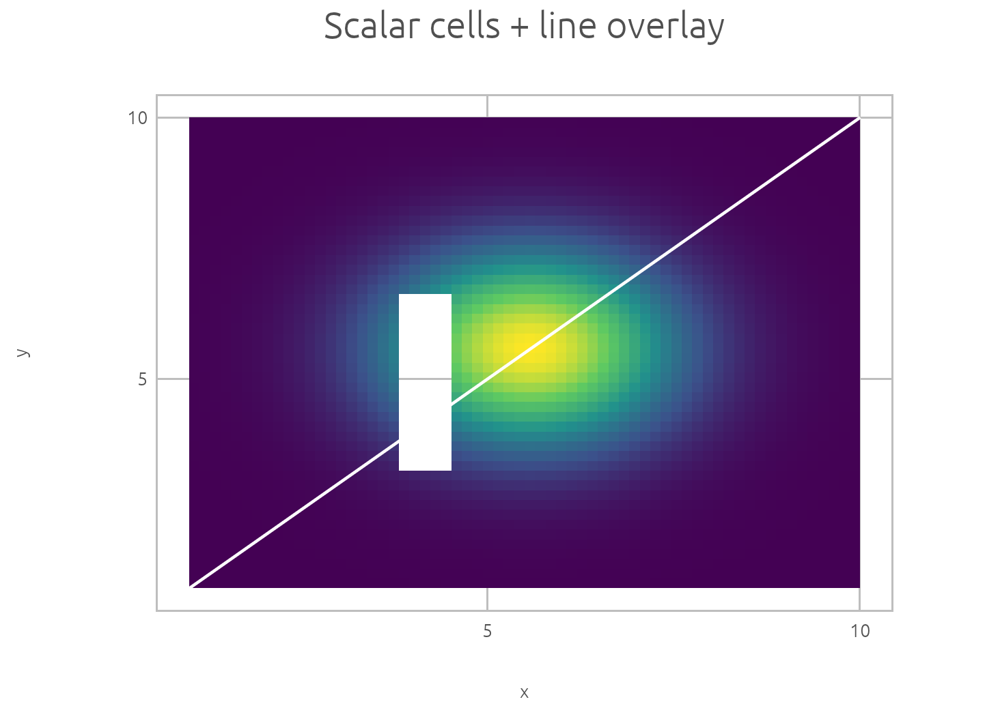](docs/images/scalar.png) | [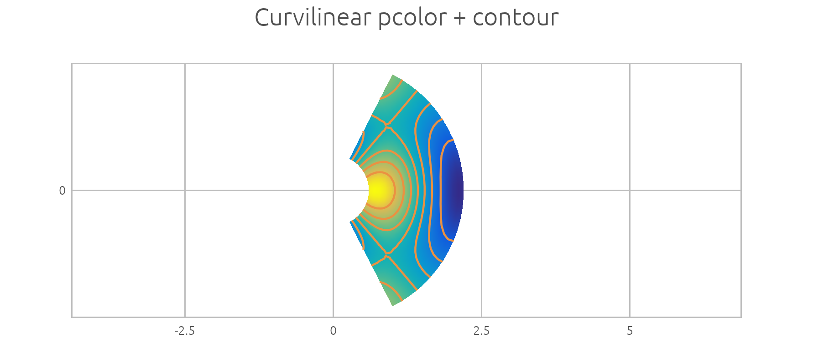](docs/images/curvilinear.png) |
| Cell color encodes intensity. A line overlay uses the same data coordinates. | Follow an isoline across a warped grid whose vertices have explicit X and Y coordinates. |

| Implicit function · `--functions` | Fills and holes · `--polygons` |
| --- | --- |
| [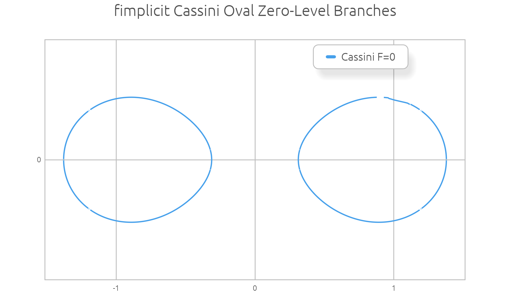](docs/images/implicit.png) | [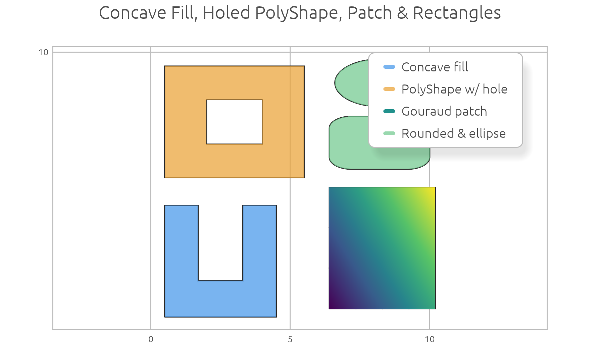](docs/images/polygons.png) |
| Trace the zero level of a Cassini oval. The gallery also samples explicit and parametric functions. | Concave outlines and polygon holes share the axes with patches and rectangles. |

| Rotational vector field · `--quiver` | Delaunay and Voronoi · `--geometry` |
| --- | --- |
| [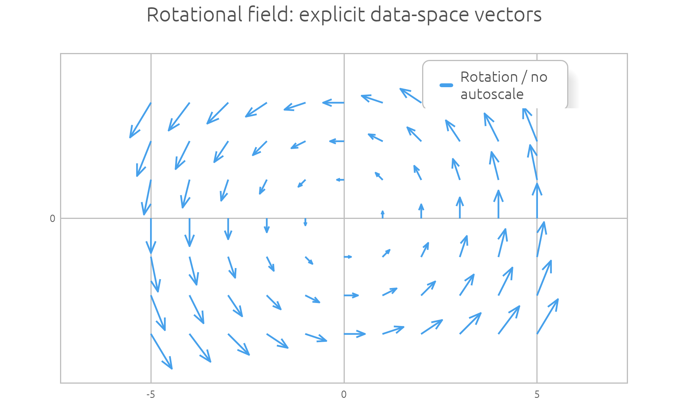](docs/images/quiver.png) | [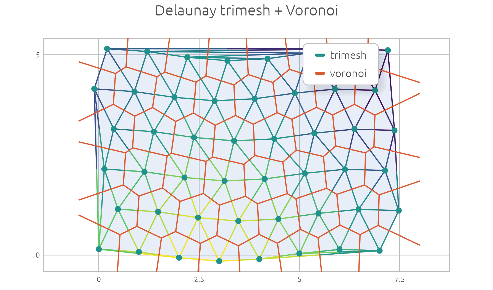](docs/images/triangulation.png) |
| Arrow orientation and length encode a vector at each sample location. | Compare the triangulation and its Voronoi cells. This gallery also includes alpha shapes, RK4 streamlines, feather vectors and sparse matrix patterns. |

<a id="gallery-statistics"></a>

### Distributions, categories and multivariate data

Choose a raincloud to see individual observations, an ECDF for time-to-event data, and a confusion matrix to locate classification errors. Other views include Q–Q and Weibull plots, Ward trees, clustered heatmaps, SPC control limits and financial waterfalls.

| Raincloud · `--distributions` | Kaplan–Meier estimate · `--stage14` |
| --- | --- |
| [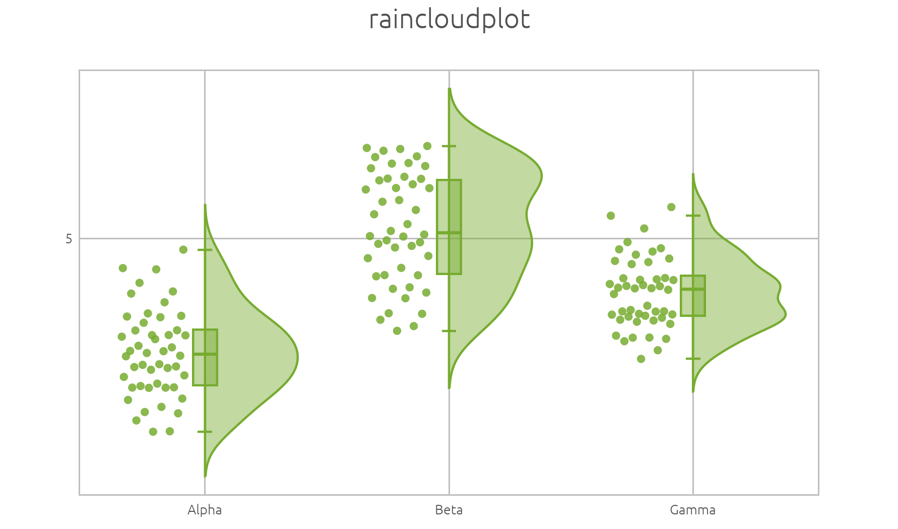](docs/images/raincloud.png) | [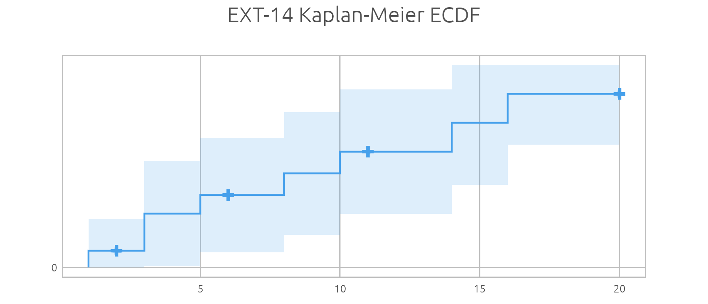](docs/images/survival.png) |
| Compare the raw dots, box summary and smoothed density for each group. | Read the cumulative event probability from the steps and its confidence interval from the band. The demo also offers the survival curve. |

| Confusion matrix · `--stage13` | PCA biplot · `--stage14` |
| --- | --- |
| [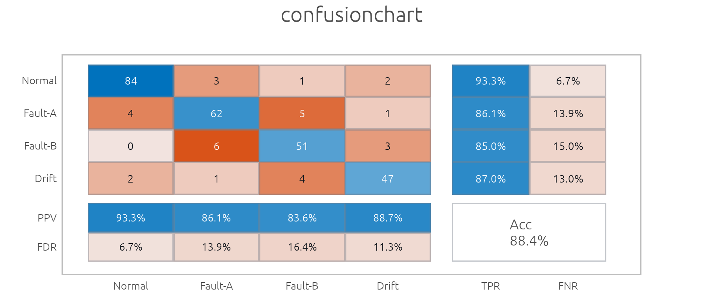](docs/images/confusion.png) | [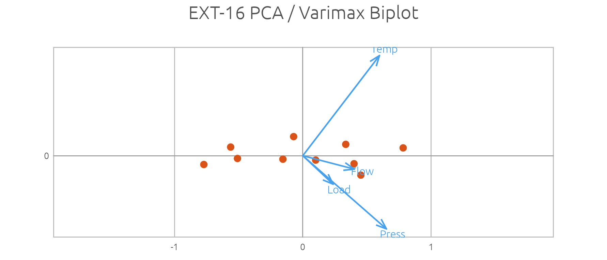](docs/images/biplot.png) |
| The diagonal counts correct predictions. Marginal summaries expose class-specific mistakes. | Inspect observation scores alongside arrows for variable loadings in the same component plane. |

| Bubble size legend · `--multivariate` | Candlestick and OHLC · `--stage14` |
| --- | --- |
| [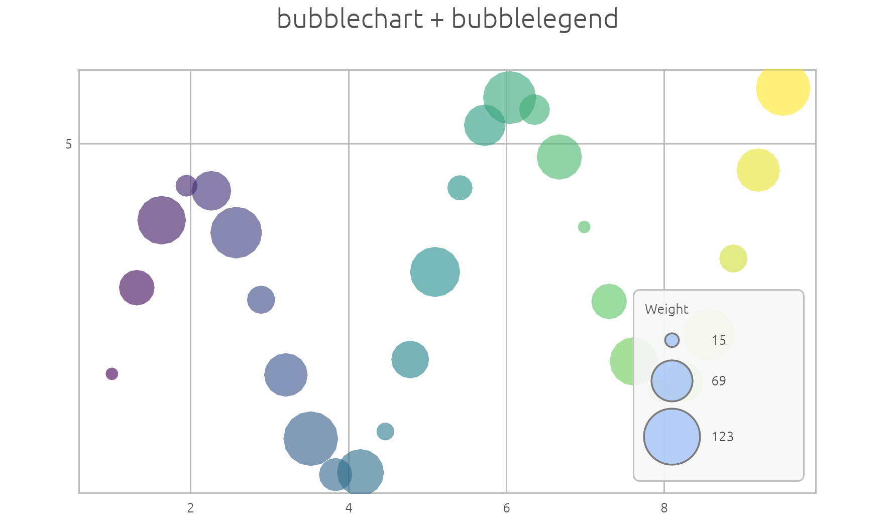](docs/images/bubbles.png) | [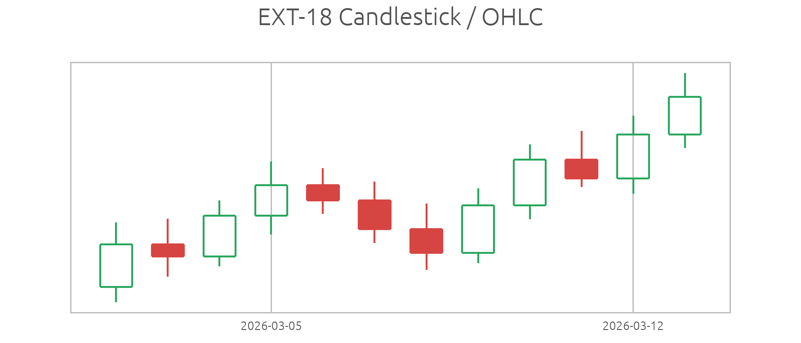](docs/images/candlestick.png) |
| Compare positions and use the size key to read a third variable. The gallery includes binned scatter, parallel coordinates and scatterplot matrices. | Read the open and close from the body and the intraperiod extremes from the wick. Switch to OHLC bars in the demo. |

<a id="gallery-control"></a>

### RF, control systems and time–frequency analysis

Open `--stage15` for impedance/admittance grids, pole–zero plots, Bode stability margins, Nyquist, Nichols and root locus. Its signal tools include FFT spectra, Welch PSD, STFT and Morlet CWT with a cone of influence. Enable **Waveform, shared cursors & step response** for the cursor and unit-step examples.

| Smith chart · `--stage15` | STFT in decibels · `--stage15` |
| --- | --- |
| [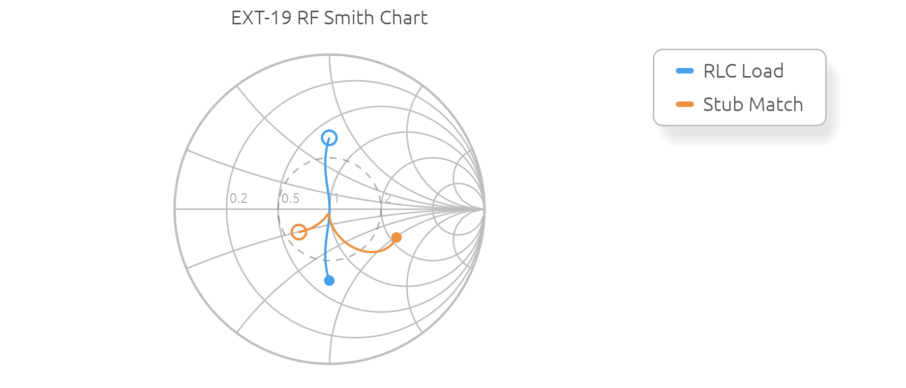](docs/images/smith.png) | [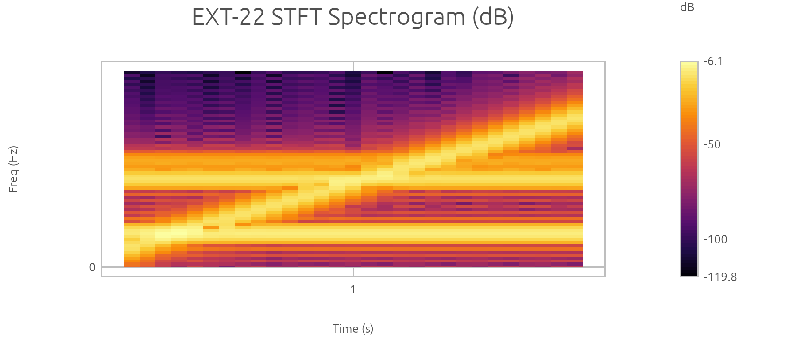](docs/images/spectrogram.png) |
| Compare the load and matching-stub trajectories in the reflection-coefficient plane. | Fixed tones form horizontal bands. The rising chirp crosses them. Read frequency vertically and magnitude from the color bar. |

| Bode magnitude and phase · `--stage15` | Z-plane poles and zeros · `--stage15` |
| --- | --- |
| [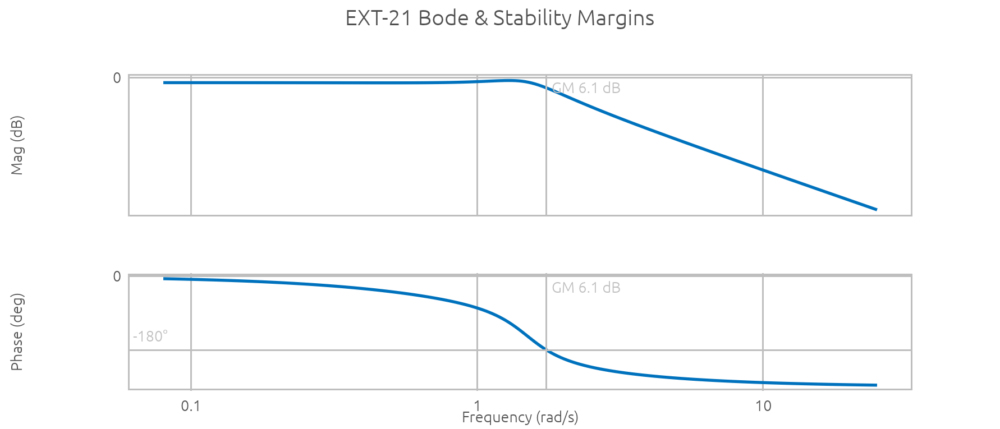](docs/images/bode.png) | [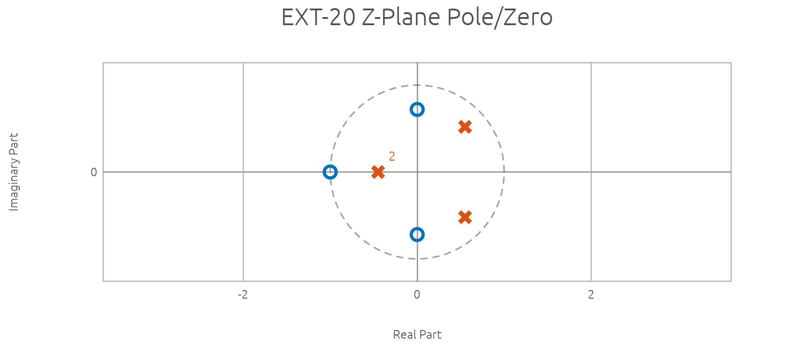](docs/images/pole-zero.png) |
| Read gain in dB and unwrapped phase in degrees at the same frequency. The demo annotates stability margins when available. | Locate poles and zeros relative to the unit circle to inspect a discrete-time system. |

| Shared time cursors · `--stage15` | Unit-step response · `--stage15` |
| --- | --- |
| [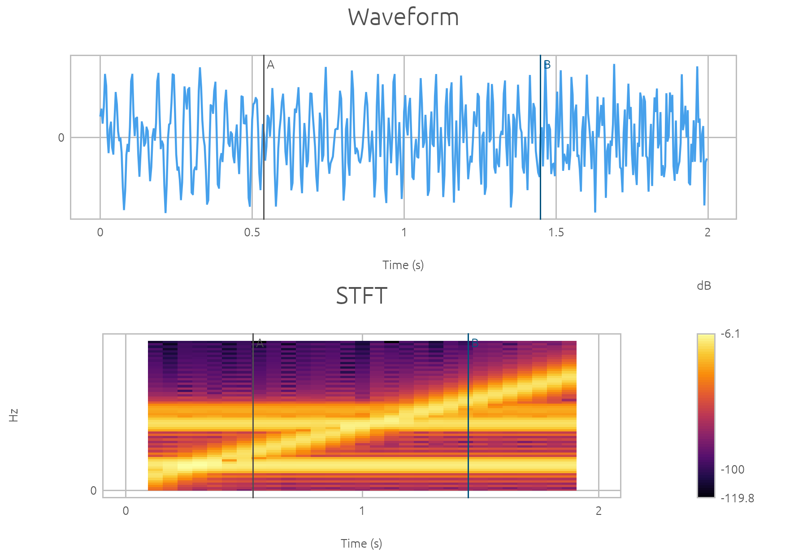](docs/images/shared-cursors.png) | [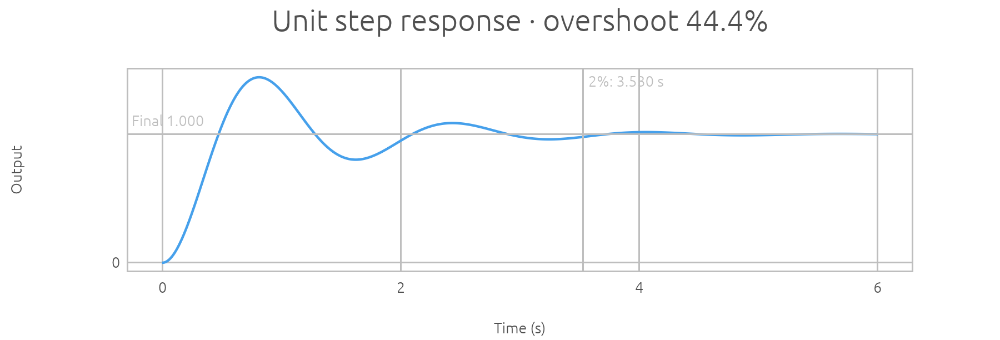](docs/images/step-response.png) |
| Click to pin A and Shift-click to pin B. Both panels mark the same times. Read Δt across panels and Δy for two pins on one plot and Y axis. | The example overshoots by 44.4%. The guides mark the final value and sampled 2% settling time. Supported plants are stable, proper, delay-free first- and second-order continuous systems. |

<a id="gallery-spatial"></a>

### Spatial data and coordinate systems

Switch projections to match the measurement. Polar axes describe direction, sky axes describe azimuth and elevation, and geographic axes account for longitude wrap. The 3D galleries add orbit, orthographic/perspective projection and depth testing.

| Polar histogram and rose · `--polar` | Satellite sky plot · `--stage13` |
| --- | --- |
| [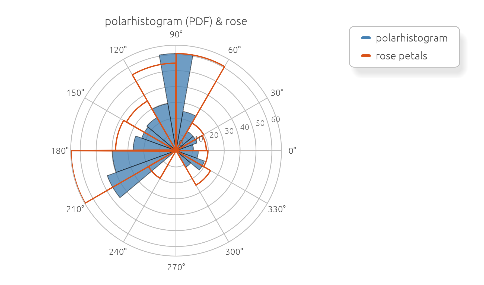](docs/images/polar-histogram.png) | [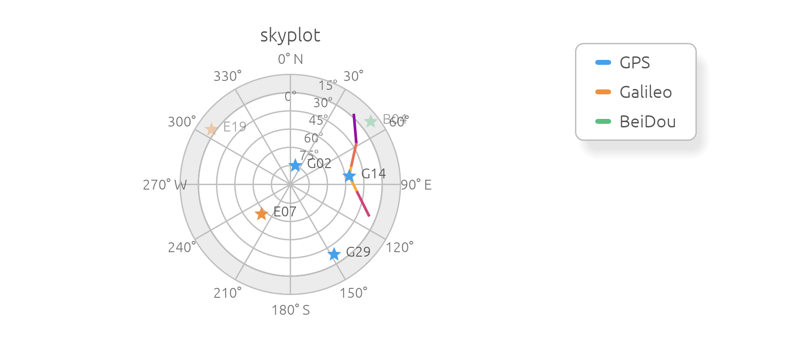](docs/images/sky.png) |
| Angular bins reveal preferred directions. The gallery also supports polar lines, bubbles, compass vectors and highlighted sectors. | North is at the top and the zenith at the center. Follow satellite tracks against an elevation mask. |

| Pacific crossing · `--geo` | WGS84 globe · `--stage16` |
| --- | --- |
| [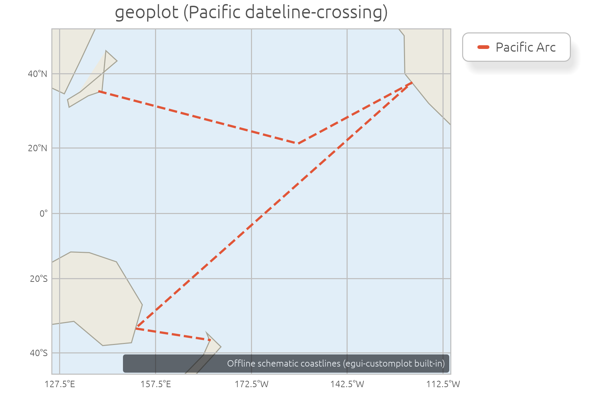](docs/images/pacific-route.png) | [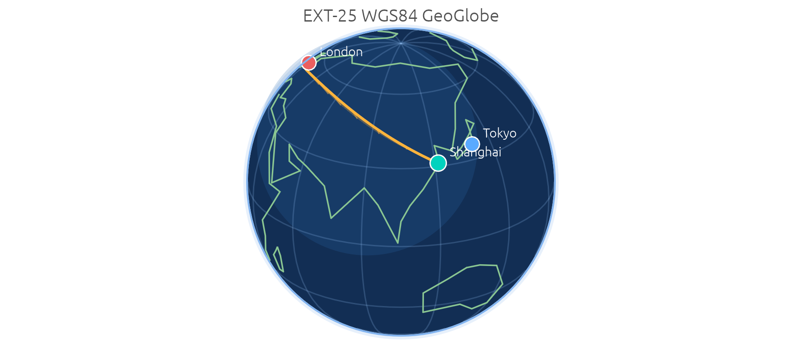](docs/images/globe.png) |
| The route splits at the date line over an offline coastline. Density and bubble overlays use geographic coordinates. | Rotate a globe with coastlines, city markers and elevated tracks. Geometry on the far side is hidden. |

| 3D scatter and bubbles · `--plot3d` | Point-cloud detail · `--stage16` |
| --- | --- |
| [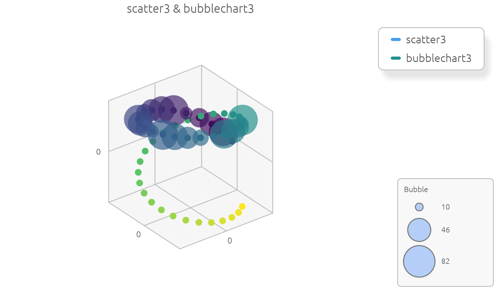](docs/images/scatter3d.png) | [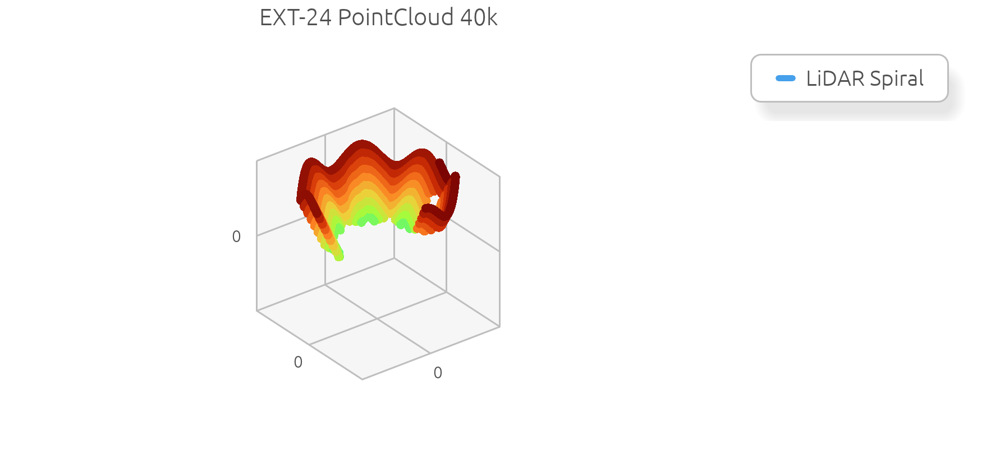](docs/images/point-cloud.png) |
| Position gives XYZ, while marker size and color can carry additional values. | The demo draws a 40,000-point spiral. Octree level-of-detail sampling adapts to the camera view. |

| Isosurface and caps · `--volumes3d` | Direct volume rendering · `--stage16` |
| --- | --- |
| [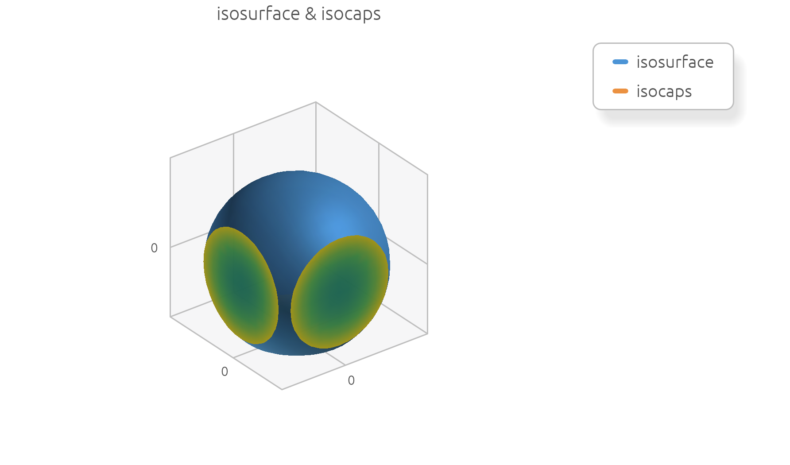](docs/images/isosurface.png) | [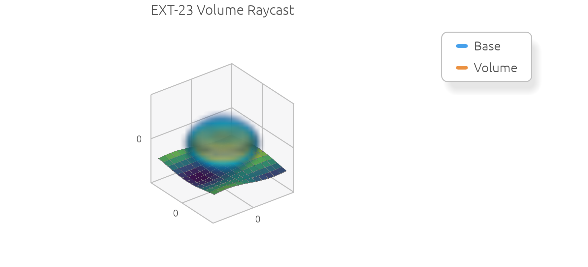](docs/images/volume.png) |
| A constant-value surface reveals the shape inside a scalar volume. Explore slices, contour slices, tetrahedra and flow in the same gallery. | The CPU raycaster samples through the volume. Switch between alpha compositing, maximum intensity and an isosurface threshold. |

<a id="gallery-relationships"></a>

### Relationships, presentation and live views

Use a graph to follow connections and a Sankey diagram to compare quantities along those connections. Annotations, shared styles and animation also work in the embedded demo.

| Layered directed graph · `--networks` | Energy flows · `--stage16` |
| --- | --- |
| [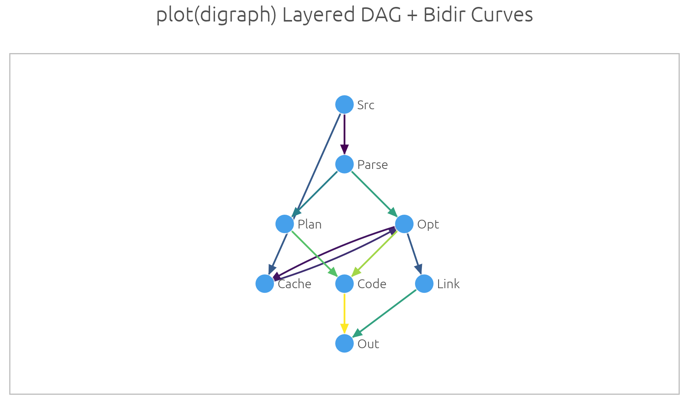](docs/images/network.png) | [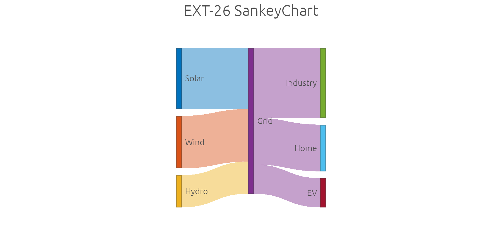](docs/images/sankey.png) |
| Follow directed edges between nodes. The gallery also includes force layout, trees and highlights. | Band widths encode flow. Other modern views cover radar profiles, hierarchical treemaps and sunbursts, and Gantt dependencies. |

| Peaks and valleys · `--custom-annotations` | Series styles · `--custom-styling` |
| --- | --- |
| [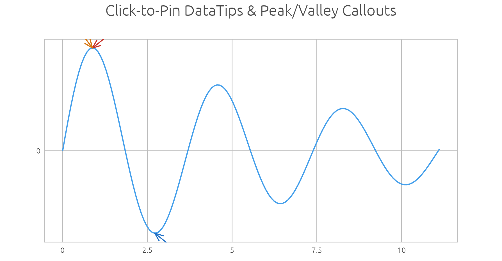](docs/images/annotations.png) | [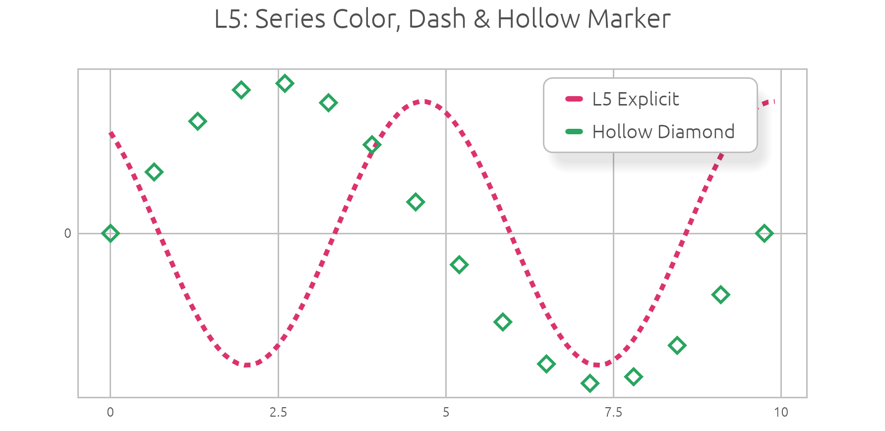](docs/images/styling.png) |
| Callouts locate extrema on a damped signal. Click near a sample to pin its data tip. | Distinguish series by dash pattern, color and hollow markers. Series can override the surrounding plot and figure theme. |

| Comet playback · `--custom-animation` | Gantt schedule · `--stage16` |
| --- | --- |
| [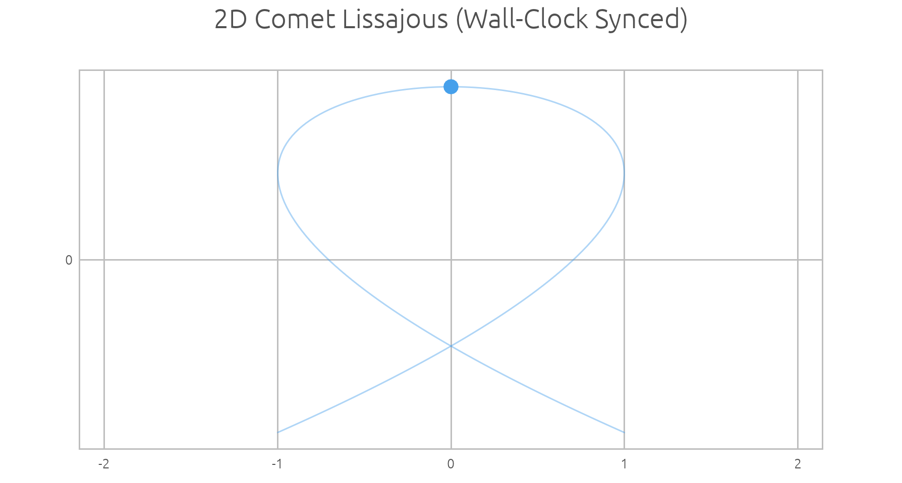](docs/images/animation.png) | [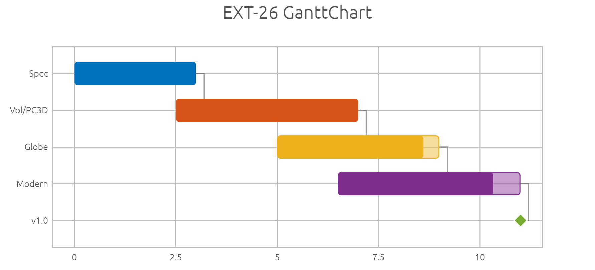](docs/images/gantt.png) |
| The dot marks the current position on a Lissajous path. The demo also animates a recording pen, streaming oscilloscope and 3D particles. | Compare task start times, durations and dependency links on one horizontal time axis. |

### Capability index

| Chart family | What you can plot | Rust entry points |
| --- | --- | --- |
| Signals and discrete samples | Continuous and stepped lines, stems, error bars, grouped and stacked bars, stacked areas and dual Y axes. | `Line`, `Stems`, `ErrorBars`, `Bars`, `Area`, `PlotYy` |
| Scalar fields and images | Show an image, color regular or warped cells by value, or label isolines over filled contours. | `PlotImage`, `Heatmap`, `Pcolor`, `CurvilinearPcolor`, `Contours`, `FilledContours` |
| Functions and planar geometry | Sample explicit and implicit curves, fill polygons with holes, shade patches, or inspect triangulations, Voronoi cells and sparse matrix patterns. | `FunctionPlot`, `ImplicitCurve`, `PolyShape`, `Patch`, `TriPlot`, `Voronoi`, `AlphaShape`, `Spy` |
| Distributions and inference | Inspect binned counts, swarms, boxes, violins and rainclouds. Compare quantiles, fit probability axes, or examine empirical distributions and survival curves. | `Histogram2`, `BinScatter`, `SwarmChart`, `BoxChart`, `ViolinPlot`, `Raincloud`, `ProbabilityPlot`, `EcdfPlot` |
| Categories and multiple variables | Compare category shares in pies and donuts, size bubbles and words by weight, inspect classification errors, or explore correlations and clusters. | `PieChart`, `BubbleChart`, `WordCloud`, `ConfusionChart`, `ParallelPlot`, `Biplot`, `Clustergram` |
| Polar, sky and geographic coordinates | Plot bearings, angular histograms, compass vectors and satellite tracks. Show routes, density and bubbles on an offline map or elevated tracks on a globe. | `PolarPlot`, `CompassPlot`, `SkyPlot`, `GeoPlot`, `GeoDensity`, `GeoBubbles`, `GeoGlobePlot` |
| 3D samples and surfaces | Inspect lines, bubbles, bars, stems, ribbons and point clouds. Add lighting, floor contours, triangular meshes or tetrahedra to show surface and mesh structure. | `Plot3D`, `PointCloud3D`, `Surface3D`, `MeshSurface3D`, `TriSurf3D`, `TetraMesh3D`, `Patch3D` |
| Volume and flow | Cut slices, extract capped isosurfaces or raycast a volume. Show vector directions with arrows and cones, and follow trajectories with streamlines, ribbons, tubes and particles. | `VolumeSlice3D`, `Isosurface3D`, `Isocaps3D`, `VolumeRender3D`, `Quiver`, `ConePlot3D`, `Streamlines`, `StreamTube3D` |
| RF, control and signal processing | Read impedance or admittance, inspect poles, zeros and frequency response, measure a unit step, or follow changing frequencies with FFT, Welch PSD, STFT and Morlet wavelets. | `SmithPlot`, `ZPlanePlot`, `BodePlot`, `NyquistPlot`, `NicholsPlot`, `RootLocus`, `StepResponsePlot`, `SpectrogramData`, `CwtPlot` |
| Process control and finance | Identify Nelson rule violations, rank contributors in a Pareto chart, compare open/high/low/close prices or trace cumulative changes in a waterfall. | `ControlChart`, `ParetoChart`, `Candlestick`, `OhlcBars`, `Waterfall2D` |
| Networks, hierarchies and schedules | Trace graph edges, branches and weighted flows. Compare profiles on radar axes, display nested shares as rectangles or rings, and place task dependencies on a timeline. | `GraphPlot`, `Graph3D`, `DendrogramPlot`, `SankeyChart`, `RadarChart`, `TreemapChart`, `SunburstChart`, `GanttChart` |
| Live data and measurement | Display regularly or irregularly sampled streams, animate a trajectory, annotate points and intervals, and pin two cursors across plots to measure timing. | `WaveformLine`, `StreamLine`, `AnimatedLine`, `Comet`, `Annotation`, `SharedCursors` |

Layout and interaction span the chart families. `Figure` arranges up to 256 cells. `PlotLayer` combines series in one cell, `AxisLink` synchronizes compatible axes, and `SharedCursors` measures between views. `StackedPlot`, `ScatterHistogram`, `PlotMatrix`, `PlotYy` and `ParetoChart` provide ready-made compositions. `Plot::legend_position` reserves space at the right or below. `Plot::color_bar` associates labeled units with the color scale.

**Reproduce the illustrations.** The demo uses `PlotSnapshot::render_at` with three pixels per logical point, then exports each chart region to PNG. Fonts and software 3D depth buffers use the target density. The `export` feature also supports hybrid SVG. Run this from the repository root.

```sh
cargo test -p customplot-demo --locked render_readme_plots -- --ignored
```

---

## Interactive Demo (`customplot-demo`)

The demo showcases **27 mutually exclusive galleries**, global `PlotDefaults` controls, OS light/dark theme sync, and PNG/SVG export:

```sh
cargo run -p customplot-demo --release --locked
cargo run -p customplot-demo --release --locked -- --dynamic-10m
cargo run -p customplot-demo --release --locked -- --glow --plot3d
```

Available CLI options:

- **Renderer & benchmark**: `--glow` (use `eframe::Renderer::Glow` instead of default `Wgpu`), `--uncapped`, `--bench-window-10m=<path.csv>`
- **2D core & fields**: (default 2D signal/power-law), `--scalar`, `--statistical`, `--stairs`, `--stems`, `--quiver`, `--polygons`, `--contours`, `--functions`, `--geometry`
- **Stats, polar & networks**: `--distributions`, `--multivariate`, `--polar`, `--networks`
- **3D, volumes & geo**: `--plot3d`, `--surfaces3d`, `--volumes3d`, `--geo`
- **Extensions & 10M**: `--stage13`, `--stage14`, `--stage15`, `--stage16`, `--dynamic-10m`
- **Customization showcases**: `--custom-axes`, `--custom-annotations`, `--custom-animation`, `--custom-styling`

Controls in the plot area: drag to pan, scroll wheel to zoom, right-drag or `Shift`+drag for box zoom, `Alt`+drag to brush points (`Esc` clears brush), double-click or focused `Home` to reset view; in 3D plots, left-drag orbits and right-drag pans.

---

## Verification & Benchmarks

```sh
cargo fmt --all -- --check
cargo test --workspace --locked
cargo test --workspace --all-features --locked
cargo check -p egui-customplot --no-default-features --locked
cargo doc -p egui-customplot --no-deps --no-default-features --locked
cargo doc --workspace --no-deps --all-features --locked
cargo clippy --workspace --all-targets --all-features --locked -- -D warnings
cargo build -p customplot-demo --release --locked
cargo run -p egui-customplot --example export_snapshot --features export --release --locked -- target/exports/example
```

Recorded Windows measurements (historical CSVs are never overwritten; CPU + tessellation benches do **not** represent GPU or swapchain FPS unless explicitly noted):

- **Headless 10M CPU + tessellation** (`1920x1080`, [2026-11-16-dynamic-10m-cpu.csv](docs/benchmarks/2026-11-16-dynamic-10m-cpu.csv)):
  - `uniform_waveform_10m_live_32k`: `total_p95 = 2.1877 ms` (`p50 = 1.9166 ms`)
  - `indexed_stream_10m_live_32k`: `total_p95 = 6.6787 ms` (`p50 = 6.0130 ms`)
  - `plotdata_auto_10m_pan_hover`: `total_p95 = 1.3365 ms` (`pick_p95 = 0.1149 ms`)
  - `scatter_auto_1m_pan`: `total_p95 = 4.8535 ms`
- **Deep zoom-out 10M CPU** (`20x` to `10^12x` + hover, [2026-11-16-deep-zoom-out-10m-cpu.csv](docs/benchmarks/2026-11-16-deep-zoom-out-10m-cpu.csv)): `total_p50 = 0.8311 ms`, `total_p95 = 1.4256 ms`, `pick_p95 = 0.0115 ms`.
- **Native Windows `eframe + wgpu` swapchain** (`AMD Radeon RX 7800 XT (Vulkan)`, `AutoNoVsync`, [2026-11-16-dynamic-10m-window-wgpu.csv](docs/benchmarks/2026-11-16-dynamic-10m-window-wgpu.csv)):
  - `wgpu_10m_waveform_live_32k`: **699.99 FPS** (2,450 frames, `frame_p50 = 1.3124 ms`, `frame_p95 = 1.7540 ms`, 131,072 B/frame upload)
  - `cpu_10m_stream_ring_live_32k` (CPU incremental tree + LOD): **174.13 FPS** (610 frames, `frame_p50 = 5.5789 ms`, `frame_p95 = 6.3164 ms`)
- **Stage 16 3D/Modern CPU** (`1280x800`, [2026-11-17-stage16-volshow-opt-cpu.csv](docs/benchmarks/2026-11-17-stage16-volshow-opt-cpu.csv) & [2026-11-17-stage16-windows-cpu.csv](docs/benchmarks/2026-11-17-stage16-windows-cpu.csv)):
  - `volshow_64x64x64_direct_alpha` (cached idle): `total_p95 = 2.889 ms` (`orbiting_uncached`: `1.893 ms`), `pcshow_200k_octree_lod_zbuffer`: `0.890 ms`, `geoglobe_wgs84_coastlines_track`: `0.053 ms`, `modern_suite_5charts_figure`: `0.104 ms`.

To run benchmarks manually (`CUSTOMPLOT_BENCH_SECONDS=2` for quick smoke runs; keep `30` s for official runs):

```sh
cargo bench -p egui-customplot --bench dynamic_10m_performance --locked
cargo bench -p egui-customplot --bench stage16_performance --locked
```

---

## Documentation

- [Architecture & Domain Boundaries](docs/ARCHITECTURE.md)
- [Implementation Progress & Evidence Log](docs/PROGRESS.md)
- [Project Plan & Milestones](docs/PLAN.md)
- [Engineering chart design and acceptance criteria](docs/EXPANSION_PLAN.md)
- [egui Integration & Performance Contracts](docs/EGUI_INTEGRATION_AND_PERFORMANCE.md)
- Stage Reports: [1](docs/STAGE_1.md) · [2](docs/STAGE_2.md) · [3](docs/STAGE_3.md) · [4](docs/STAGE_4.md) · [5](docs/STAGE_5.md) · [6](docs/STAGE_6.md) · [7](docs/STAGE_7.md) · [8](docs/STAGE_8.md) · [9](docs/STAGE_9.md) · [10](docs/STAGE_10.md) · [11](docs/STAGE_11.md) · [12](docs/STAGE_12.md) · [13](docs/STAGE_13.md) · [14](docs/STAGE_14.md) · [15](docs/STAGE_15.md) · [16](docs/STAGE_16.md)
- Community & Policies: [Contributing](CONTRIBUTING.md) · [Changelog](CHANGELOG.md) · [Security](SECURITY.md)

---

## Contributing & License

Contributions are welcome — please read [CONTRIBUTING.md](CONTRIBUTING.md) before opening a pull request.

Dual-licensed under either of:

- Apache License, Version 2.0 ([LICENSE-APACHE](LICENSE-APACHE))
- MIT License ([LICENSE-MIT](LICENSE-MIT))

at your option, matching [`egui`](https://github.com/emilk/egui). Unless you explicitly state otherwise, any contribution intentionally submitted for inclusion in this repository shall be dual-licensed as above, without any additional terms or conditions (Apache-2.0 Section 5).
