[English](README.md) | 简体中文

# egui-customplot

egui-customplot 是面向科学与工程应用的 Rust 绘图库，可在已有的 [`egui`](https://github.com/emilk/egui) 界面中显示实时波形、查看三维体数据或测量控制系统的响应。采样数据与视图状态均由宿主应用持有。

| 三维曲面 · `--surfaces3d` | 填色等高线 · `--contours` |
| --- | --- |
| [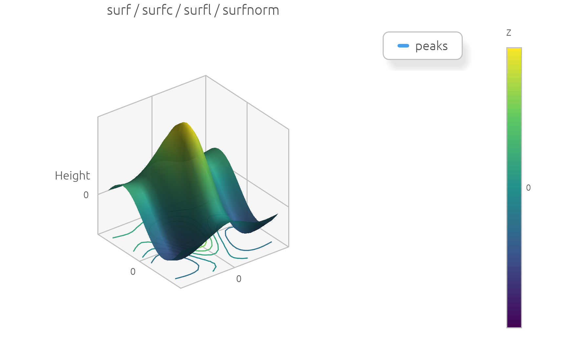](docs/images/surface.png) | [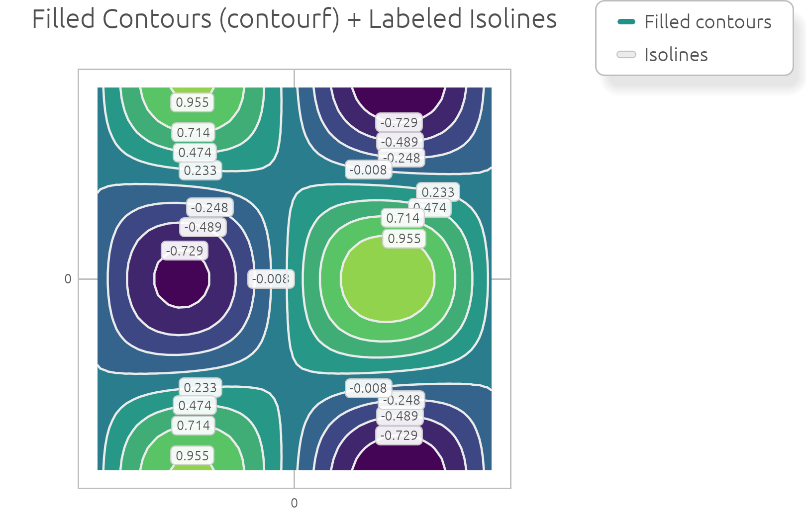](docs/images/contours.png) |
| 旋转视角观察峰谷，用底面的等高线判断它们的位置，右侧色标给出高度。 | 在二维平面上看标量场的分布。填色区分数值区间，线上的标签给出具体等值。 |

可按用途浏览[图表与能力图鉴](#图表与能力图鉴)，也可在[完整能力索引](#完整能力索引)中按名称查找。`0.1.1` 新增高清导出、图外图例、STFT 色标、共享 A/B 游标和单位阶跃响应图。

> **集成与验证范围**
>
> 演示程序提供 27 组交互图例。启用 `export` 可导出 PNG 和混合 SVG，启用 `wgpu` 可用宿主的 GPU 加速受支持的序列。三维曲面与体数据由 CPU 渲染。Linux、macOS、WebAssembly 的实机显示验证及长时间资源回归仍待完成。

---

## 核心特性

- **架构与宿主契约**
  - **宿主持有数据（`Arc`）**：`PlotData`、`GridData`、`ContourData`、`Surface3DData`、`ScalarVolume3D`、`PointCloud3DData` 等不可变/按版本共享的数据源留在业务模型中；`PlotState` 与 `Plot3DState` 仅保存视图范围与交互状态，不滞留样本或 GPU 纹理。
  - **多遍布局严格幂等**：在 `egui::Context::request_discard` 触发重复布局时，平移/缩放、框选/刷选、`AxisLink` 联动、`PlotStream` / 墙钟动画推进以及延迟文件导出均严格按帧去重。
  - **七域分层架构**：库源码按 `axis / data / interaction / layout / model / render / widget`（及 `diagnostics`）划分职责边界，由 `tests/architecture.rs` 强制校验目录规范与单文件 `<= 400` 行上限。
- **三层性能架构（`L1` / `L2` / `L3`）**
  - **L1 零配置智能默认**：`PlotData::new` 对 `>= 8,192` 点的单调非降 X 序列在 64 MiB 预算内自动建立索引；`LineSampling::Auto` 与 `MarkerSampling::Auto` 缩小自动峰值保真、放大自动切换精确绘制；`PlotState` 内置 2 MiB 自动缓存；原始点拾取采用 2D 屏幕包围盒分支定界剪枝。
  - **L2 全量客制化控制**：显式 `LineSampling::{Auto, Exact, Visible, MinMax}`、`MarkerSampling::{Auto, Exact, PixelGrid}`、`RenderBackend::{Auto, Painter, Wgpu}`、五层样式继承（`defaults -> Theme -> 继承样式/Figure -> Plot -> Series`）、`PlotDefaults`、`PlotCache`、`Plot::pan_limits`、双 Y 轴、线性/对数/Probit/Weibull/时间/时长/分类坐标轴，以及自包含 PNG/SVG 导出（`feature = "export"`）。
  - **L3 千万点流式与 `wgpu` 加速**：零拷贝环形 `IndexedStream`（`StreamLine`）、`O(1)` 切片 `UniformWaveform`（`WaveformLine`），以及可选 `feature = "wgpu"`（`register_wgpu`）复用宿主 `egui_wgpu::RenderState` 执行 WGSL Compute 列极值规约与实例化渲染；无硬件后端或导出快照时自动回退 CPU `Painter`。

---

## 定制图表组件

上方曲面图将高度刻度固定在 X 最小值与 Y 最大值交汇的竖棱上。旋转视角时，X 和 Y 仍各自根据投影选择标注位置。固定端点采用数据坐标，反转 X 轴后，“X 最小值”仍指向同一个数据端点。

```rust
use egui_customplot::{Axis3D, AxisEdge3D, Plot3D};

let surface = Plot3D::new("surface").z_axis(
    Axis3D::new().label("Height").label_edge(AxisEdge3D::new(false, true)),
);
```

| 要调整的部分 | 公开入口 |
| --- | --- |
| 一根 3D 轴 | 用 `Axis3D::label_edge` 固定标注棱，或实现 `AxisDecoration3D` 选棱、调整文字位置及绘制。用 `ScaleMapping3D` 在已有有效域上提供单调的正反变换。用 `CameraLens3D` 设置投影镜头，拾取射线使用对应的逆变换。`CameraNavigation3D` 可替换旋转、平移和滚轮手势到相机位置的映射。 |
| 图例、标题、色标 | 二维和三维笛卡尔图、地理图均可接入 `LegendComponent` 和 `PlotDecoration`。极坐标图也支持替换图例和标题。组件按逻辑点测量尺寸。外置组件获得独立的裁剪区域，图内导航使用剩余区域。 |
| 宿主数据图层 | `PlotLayer::custom(&layer)` 可与二维内置图层混排，提供范围、批次绘制和可选拾取。捕获期间可以提交导出专用图元。三维使用 `Layer3D::Custom` 提交点、折线或三角形批次，通过修订号使深度缓存失效。 |
| 控制系统图 | 用 `BodePlot::show_with_panels` 分别配置幅频、相频子图，通过 `panel_at` 取得指针所在子图的真实坐标变换。用 `StepResponsePlot::configure_plot` 和 `configure_curve` 调整坐标轴、标注及响应曲线。 |

[宿主组件集成用例](crates/egui-customplot/tests/host_components.rs) · [三维布局、比例尺与投影用例](crates/egui-customplot/tests/customization_3d.rs)

## 环境要求与 Cargo 特性

- **Rust**：**1.95+**（Edition `2024`；实测 Rust `1.100.0` / Windows x64 / `egui 0.37.0`）
- **Cargo Feature（`crates/egui-customplot/Cargo.toml`）**：
  - `default = []`：核心 CPU + `egui::Painter` 绘图（仅依赖 `egui`）。
  - `export`：启用 `PlotSnapshot`、`ExportOptions` 与 `CaptureLimits` 自包含 PNG / 混合矢量 SVG 导出（引入 `png`）。
  - `wgpu`：启用 `register_wgpu`、`register_wgpu_with_config`、`set_wgpu_budget` 与 `WgpuPlotConfig`（引入 `egui-wgpu`、`wgpu`、`bytemuck`）。

---

## 快速开始

在 `Cargo.toml` 中引入 `egui-customplot`：

```toml
[dependencies]
egui = "0.37.0"
egui-customplot = "0.1.1"
# 按需开启特性：
# egui-customplot = { version = "0.1.1", features = ["export", "wgpu"] }
```

### 最小二维绘图示例

跨帧在宿主模型中保留样本数据与 `PlotState`（不要每帧重建 `PlotData`）：

```rust
use egui_customplot::{Line, Plot, PlotData, PlotState};

// 初始化时：
let data = PlotData::new(vec![[0.0, 0.0], [1.0, 1.0], [2.0, 0.0]]);
let mut state = PlotState::default();

// 在宿主的 egui UI 闭包中（ui: &mut egui::Ui）：
Plot::new("signal")
    .height(320.0)
    .allow_scroll_zoom(true) // 库默认关闭滚轮缩放以免抢占父 ScrollArea
    .allow_box_zoom(true)
    .show(ui, &mut state, &[Line::new(&data).name("信号")]);
```

### 异构图层叠加（`PlotLayer`）

```rust
use egui_customplot::{Bar, BarData, Bars, ErrorBar, ErrorBarData, ErrorBars, Plot, PlotState};

let bars = BarData::new(vec![Bar::new(1.0, 2.0), Bar::new(2.0, -1.0)]);
let errors = ErrorBarData::new(vec![ErrorBar::new([1.0, 2.0]).y_error([0.2, 0.4])]);
let mut state = PlotState::default();

Plot::new("measurements").show_layers(
    ui,
    &mut state,
    &[Bars::new(&bars).into(), ErrorBars::new(&errors).into()],
);
```

完整使用说明可阅读 [使用手册](crates/egui-customplot/docs/guide.md) 或本地构建支持页内 `EN | 简体中文` 一键切换的 `rustdoc` 文档：

```sh
cargo doc --workspace --no-deps --all-features --open
```

---

## 图表与能力图鉴

图名旁标出了演示参数。例如，运行 `cargo run -p customplot-demo --release --locked -- --stage15` 可打开射频与控制画廊，替换最后一个参数即可复现其他示例。点击图片可查看原始分辨率。

[信号](#gallery-signals) · [场与几何](#gallery-fields) · [统计](#gallery-statistics) · [射频与控制](#gallery-control) · [空间数据](#gallery-spatial) · [关系与动态](#gallery-relationships)

<a id="gallery-signals"></a>

### 信号、采样与时间

连续变化用折线，采样间保持不变的量用阶梯线，独立观测用针状图。默认画廊还可切换到幂律数据和对数坐标。

| 信号与观测点 · 默认画廊 | 采样保持 · `--stairs` |
| --- | --- |
| [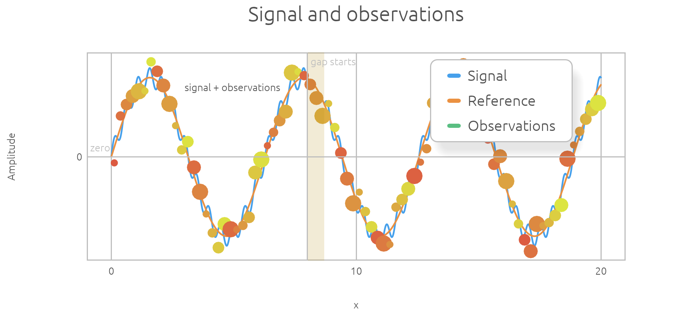](docs/images/signal.png) | [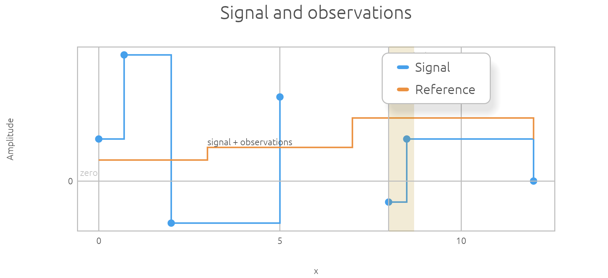](docs/images/stairs.png) |
| 把观测点叠在连续信号上，悬停可读取原始采样值。 | 标记给出采样位置，水平线段的长度表示该值保持了多久。 |

| 正负针状图 · `--stems` | 带误差棒的柱状图 · `--statistical` |
| --- | --- |
| [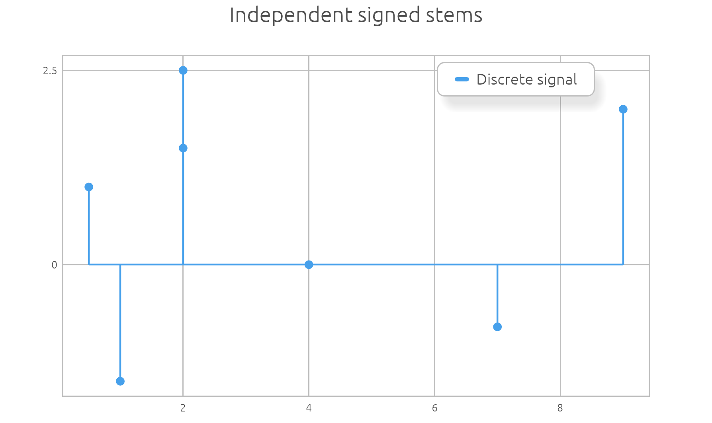](docs/images/stems.png) | [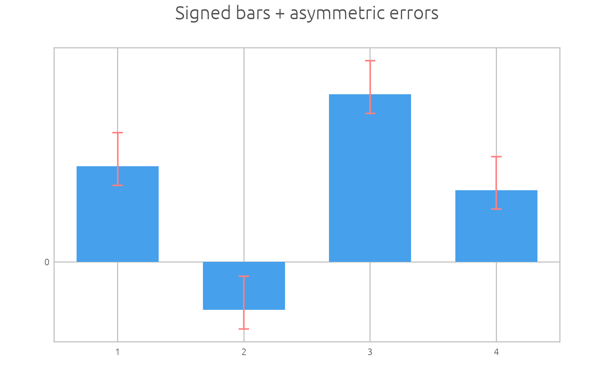](docs/images/bar-errors.png) |
| 针尖到基线的距离表示大小，基线上下区分正负。 | 比较正负测量值和上下不对称的误差区间。同一画廊还展示自定义分箱直方图。 |

| 同一时间轴，两种单位 · `--custom-axes` | 千万点波形 · `--dynamic-10m` |
| --- | --- |
| [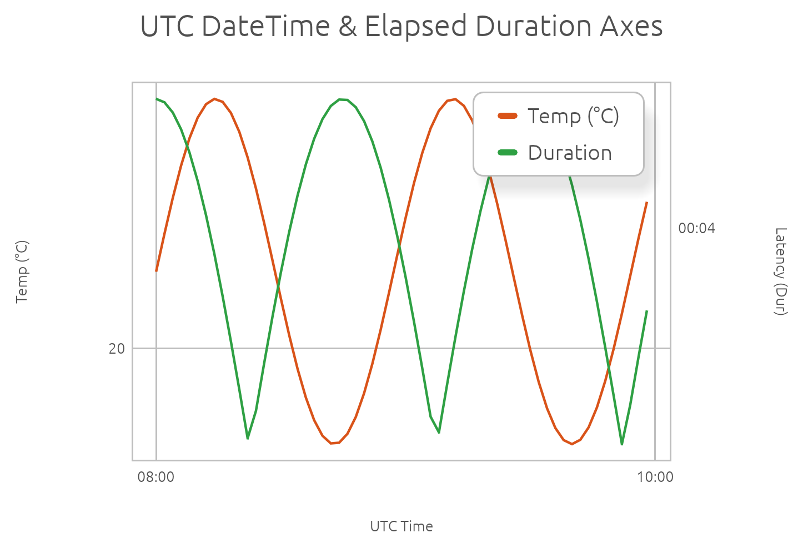](docs/images/dual-axis.png) | [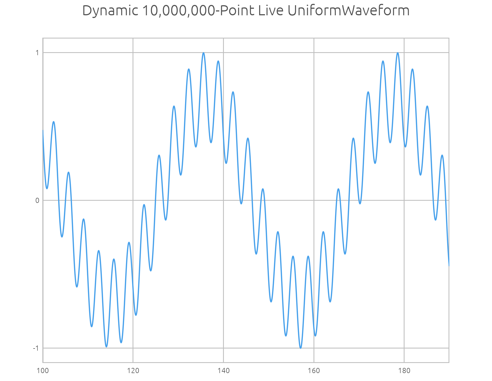](docs/images/streaming.png) |
| 沿同一 UTC 时间轴对齐温度和耗时，两侧纵轴分别标明单位，图例置于右侧图外。 | 图中放大了千万点等间隔波形中的 90 秒。演示按批更新，还可切换到存储带时间戳采样的索引环形缓冲区。 |

<a id="gallery-fields"></a>

### 场、函数与几何

页首的曲面与填色等高线展示了标量场的两种视图。下面依次展示规则网格、曲线网格、隐式曲线、多边形、向量和非结构网格。

| 标量网格叠加折线 · `--scalar` | 曲线网格 · `--stage13` |
| --- | --- |
| [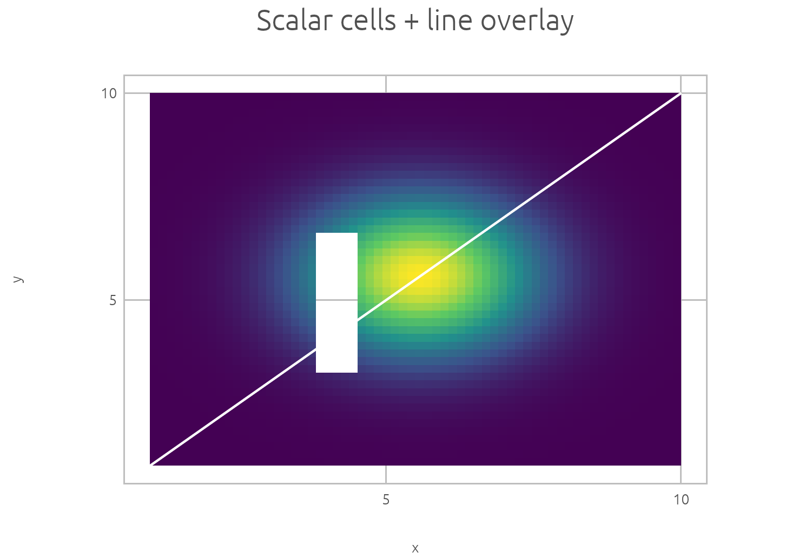](docs/images/scalar.png) | [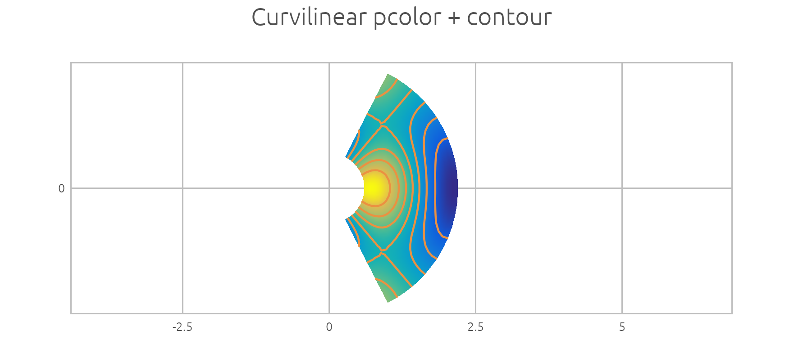](docs/images/curvilinear.png) |
| 网格颜色表示强度，叠加的折线使用同一套数据坐标。 | 在弯曲网格上追踪同一等值线，每个顶点都有独立的 X、Y 坐标。 |

| 隐式函数 · `--functions` | 填充与孔洞 · `--polygons` |
| --- | --- |
| [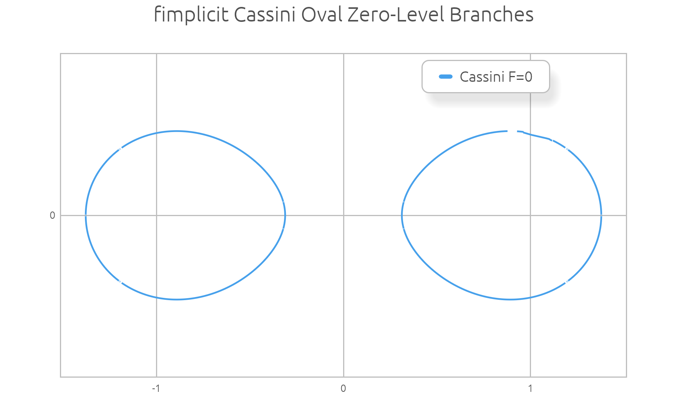](docs/images/implicit.png) | [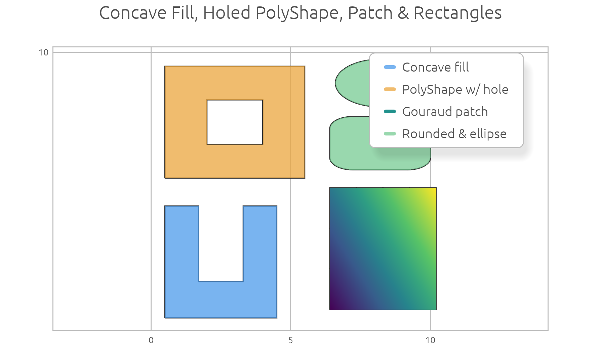](docs/images/polygons.png) |
| 沿零等值线绘制卡西尼卵形线。该画廊也支持显式函数和参数方程采样。 | 凹多边形、带孔区域、面片和矩形可以在同一坐标系内叠加。 |

| 旋转向量场 · `--quiver` | Delaunay 三角网与 Voronoi 分区 · `--geometry` |
| --- | --- |
| [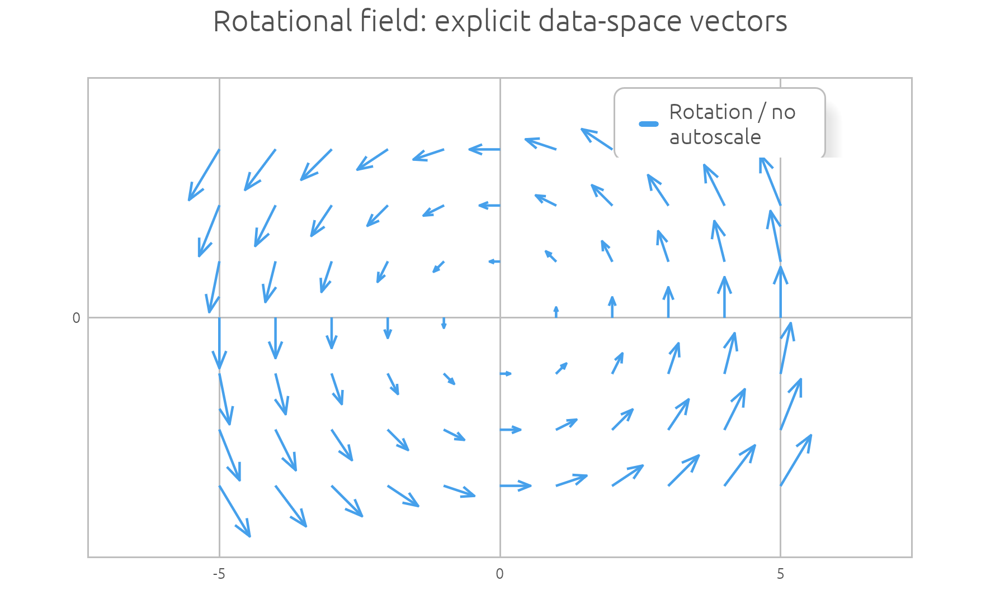](docs/images/quiver.png) | [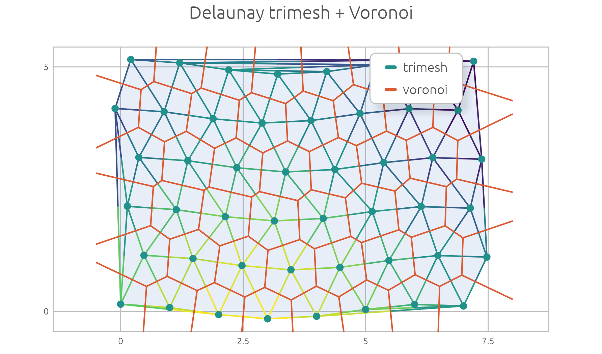](docs/images/triangulation.png) |
| 每个采样位置的箭头用方向和长度表示向量。 | 对照三角剖分与 Voronoi 分区。同一画廊还可查看 alpha 形状、RK4 流线、羽状向量和稀疏矩阵非零分布。 |

<a id="gallery-statistics"></a>

### 分布、类别与多变量数据

看单个观测值可用雨云图，看事件发生时间可用经验分布，找分类错误可用混淆矩阵。此外可绘制 Q–Q 图、威布尔概率图、Ward 聚类树、双向聚类热图、SPC 控制图和增减瀑布图。

| 雨云图 · `--distributions` | Kaplan–Meier 估计 · `--stage14` |
| --- | --- |
| [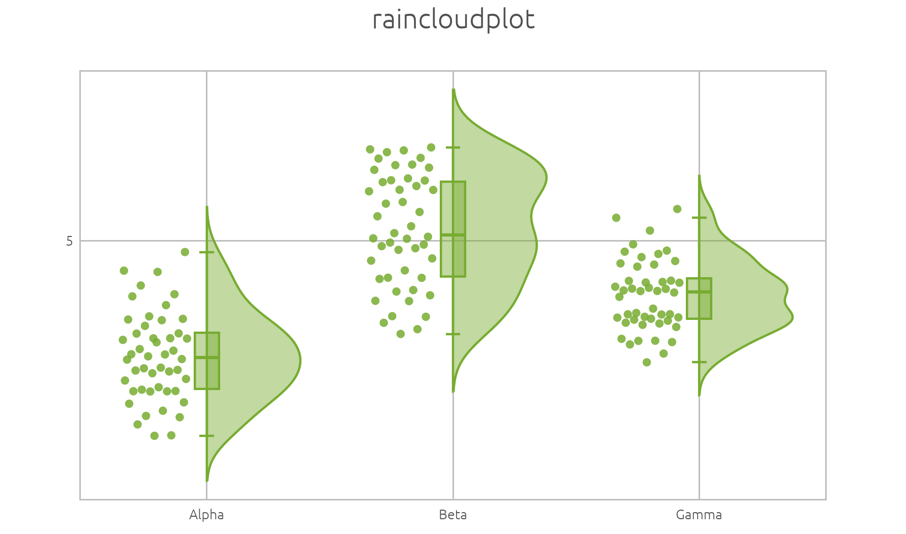](docs/images/raincloud.png) | [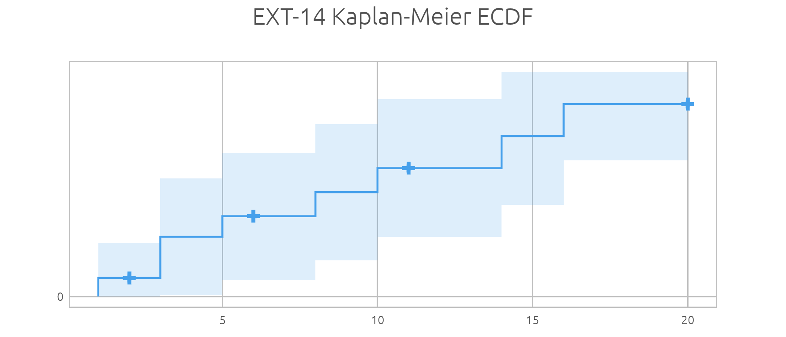](docs/images/survival.png) |
| 每组的散点、箱线和半小提琴分别展示原始观测、分位数与平滑密度。 | 阶梯线表示累计事件概率，色带表示置信区间。演示中还可切换到生存曲线。 |

| 混淆矩阵 · `--stage13` | PCA 双标图 · `--stage14` |
| --- | --- |
| [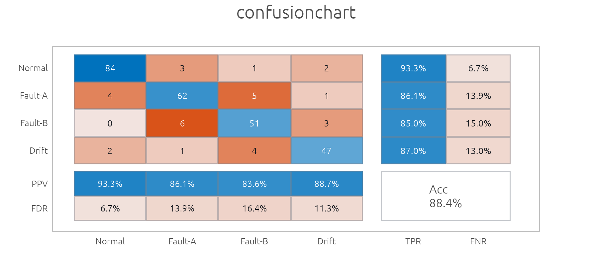](docs/images/confusion.png) | [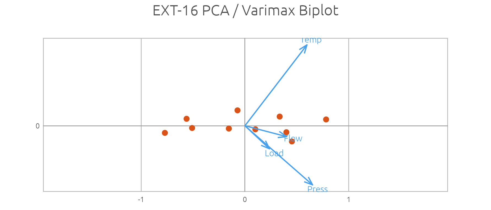](docs/images/biplot.png) |
| 对角线统计正确分类，行列边缘的汇总揭示哪些类别容易混淆。 | 在同一主成分平面上同时读样本得分与变量载荷向量。 |

| 气泡尺寸图例 · `--multivariate` | K 线与 OHLC · `--stage14` |
| --- | --- |
| [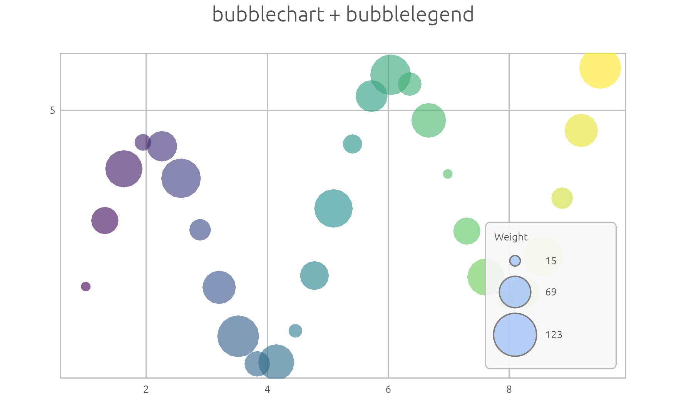](docs/images/bubbles.png) | [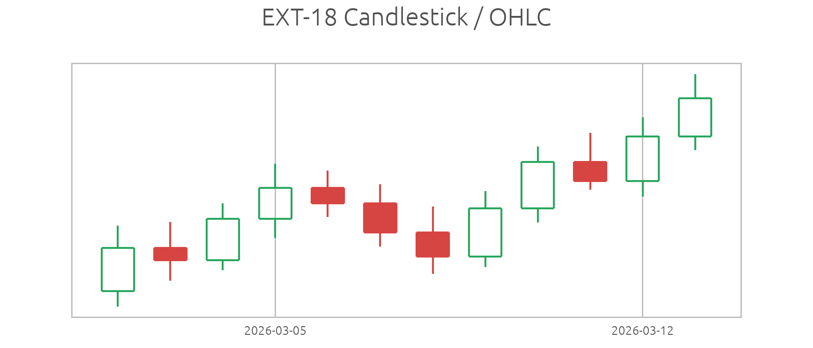](docs/images/candlestick.png) |
| 按位置比较样本，再对照尺寸图例读取第三个变量。画廊还包含分箱散点、平行坐标和散点矩阵。 | 实体两端表示开盘和收盘，影线表示期间高低点，也可切换为 OHLC 竹线。 |

<a id="gallery-control"></a>

### 射频、控制系统与时频分析

打开 `--stage15` 可查看阻抗与导纳网格、零极点、Bode 稳定裕度、Nyquist、Nichols 和根轨迹。信号工具包括 FFT 频谱、Welch 功率谱密度、STFT 和带影响锥的 Morlet 小波图。勾选「波形、共享游标与阶跃响应」可复现游标与阶跃响应示例。

| Smith 圆图 · `--stage15` | 带 dB 色标的 STFT · `--stage15` |
| --- | --- |
| [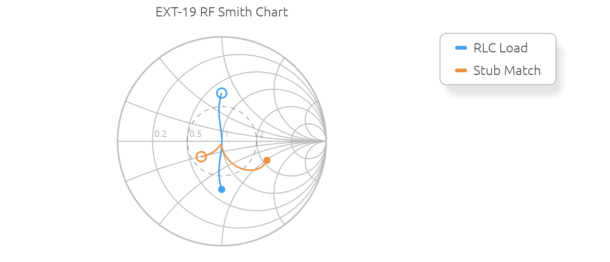](docs/images/smith.png) | [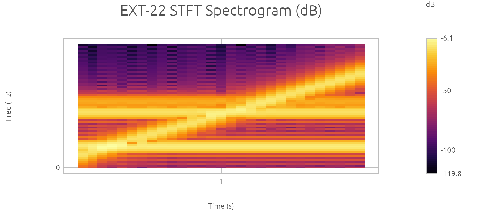](docs/images/spectrogram.png) |
| 在反射系数平面上比较负载和匹配短截线的轨迹。 | 固定频率形成水平带，上扫频分量斜穿其间。纵轴读频率，右侧色标读 dB 值。 |

| Bode 幅频与相频 · `--stage15` | Z 平面零极点 · `--stage15` |
| --- | --- |
| [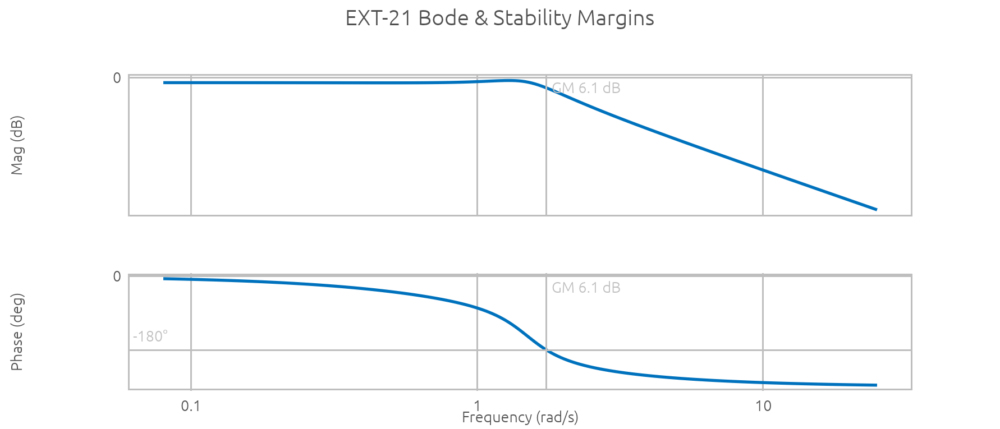](docs/images/bode.png) | [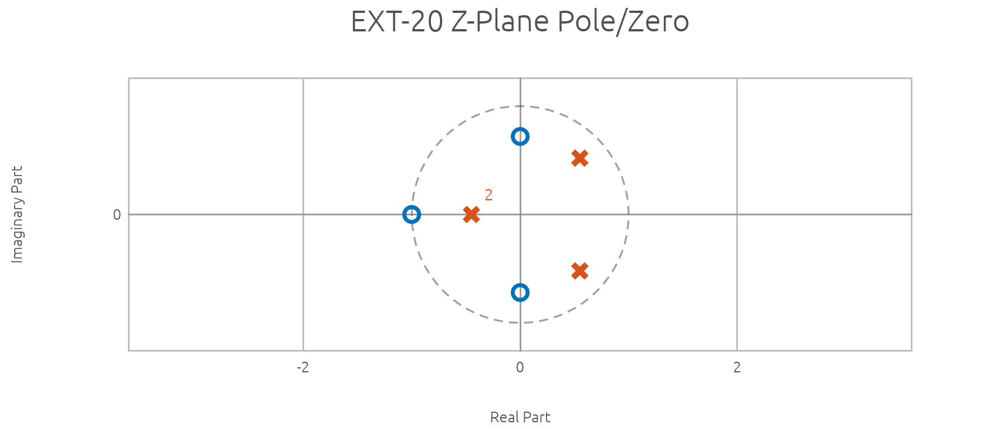](docs/images/pole-zero.png) |
| 沿同一对数频率轴分别读取增益（dB）和展开相位（度）。可计算出稳定裕度时，图中会自动标注。 | 将极点、零点与单位圆对照，观察离散时间系统的特性。 |

| 共享时间游标 · `--stage15` | 单位阶跃响应 · `--stage15` |
| --- | --- |
| [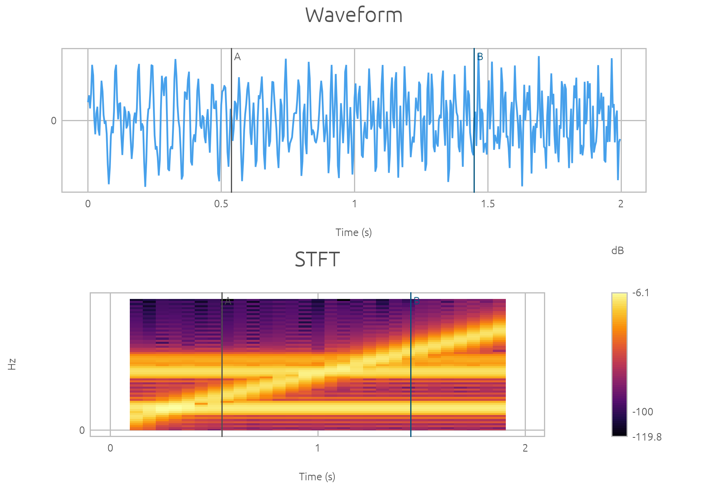](docs/images/shared-cursors.png) | [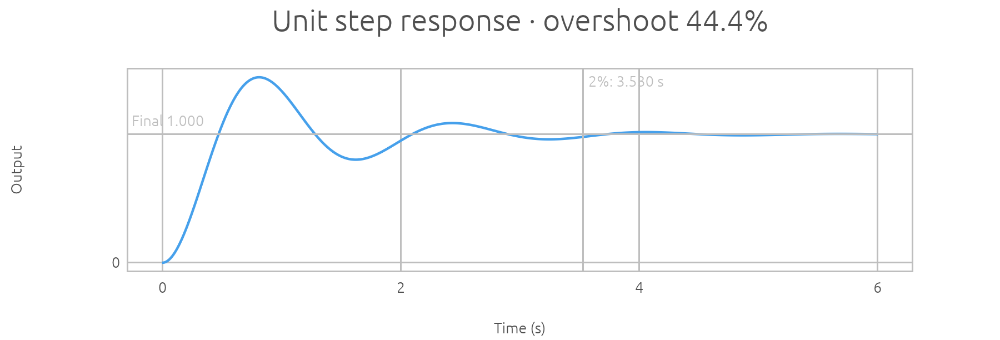](docs/images/step-response.png) |
| 点击固定 A，Shift 加点击固定 B。两图会标出相同的时刻，跨图可读 Δt，同图同一 Y 轴上的两点还可读 Δy。 | 示例峰值超过稳态值 44.4%，辅助线标出稳态值和按采样估算的 2% 调节时间。支持稳定、无延迟且分子阶数不高于分母的连续一阶或二阶系统。 |

<a id="gallery-spatial"></a>

### 空间数据与坐标系

按测量量选择投影。极坐标用于方向分布，天空图使用方位角与仰角，地理坐标处理经度环绕。三维画廊支持轨道旋转、正交或透视投影以及深度测试。

| 极坐标直方图与玫瑰图 · `--polar` | 卫星天空图 · `--stage13` |
| --- | --- |
| [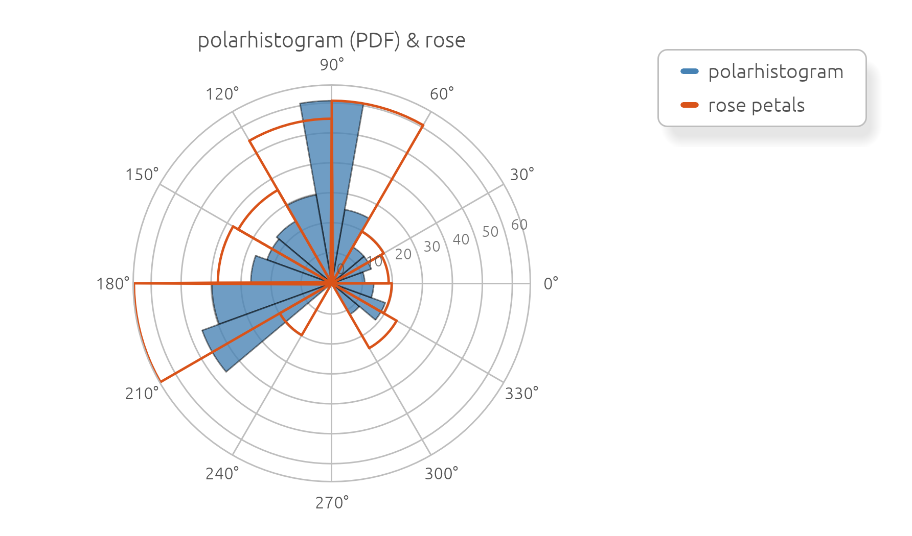](docs/images/polar-histogram.png) | [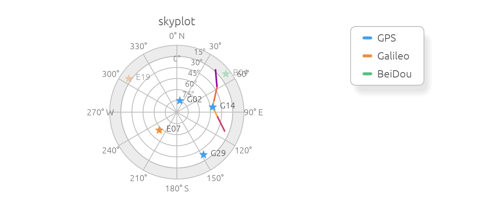](docs/images/sky.png) |
| 按角度分箱可看出优势方向，也可绘制极坐标曲线、气泡、罗盘向量和扇区标记。 | 北方在上，天顶在中心，卫星轨迹可与仰角遮罩对照。 |

| 跨太平洋航线 · `--geo` | WGS84 地球 · `--stage16` |
| --- | --- |
| [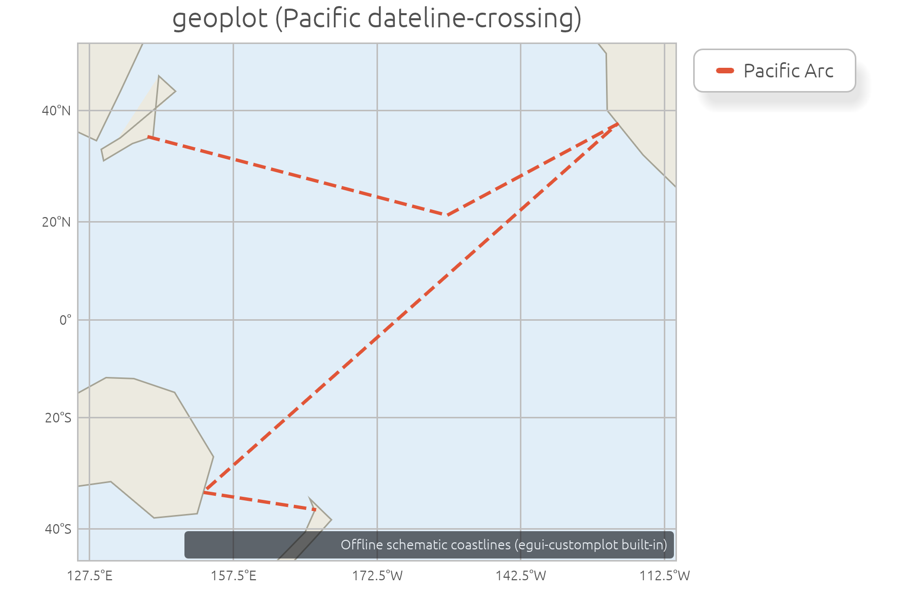](docs/images/pacific-route.png) | [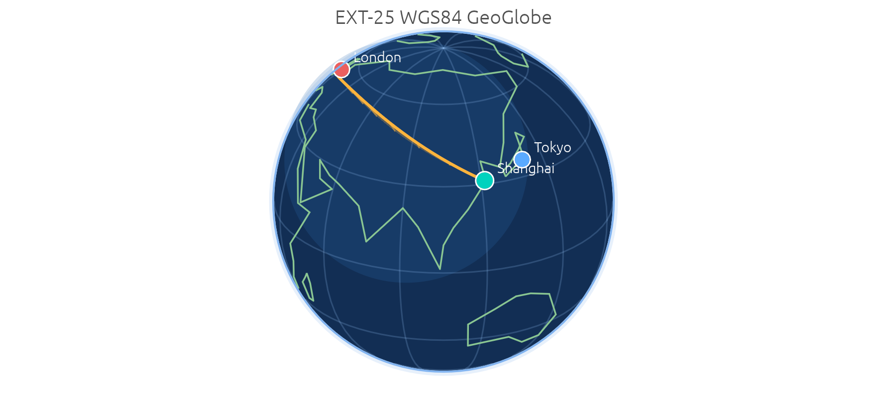](docs/images/globe.png) |
| 航线在日期变更线处自动分段，底图为离线海岸线。还可在经纬坐标上叠加密度和气泡。 | 旋转带有海岸线、城市标记和高程轨迹的地球，背面的图元随视角被遮挡。 |

| 三维散点与气泡 · `--plot3d` | 点云细节 · `--stage16` |
| --- | --- |
| [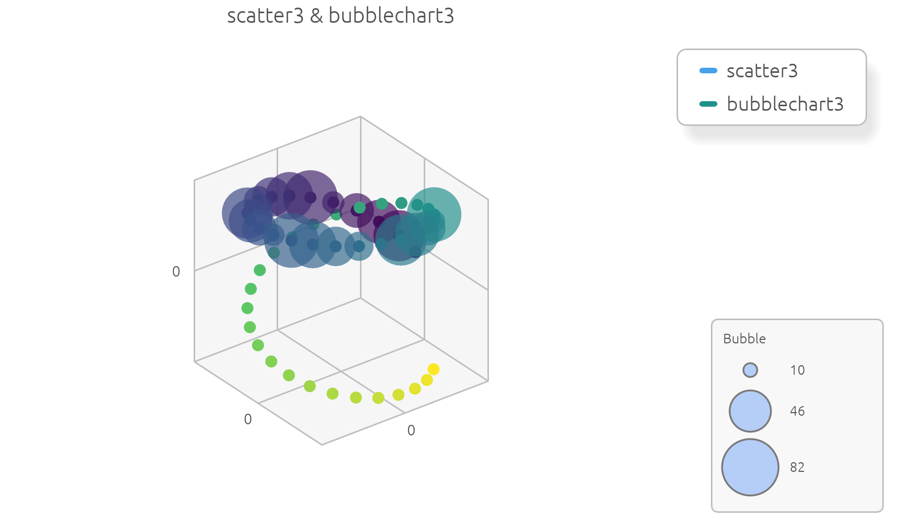](docs/images/scatter3d.png) | [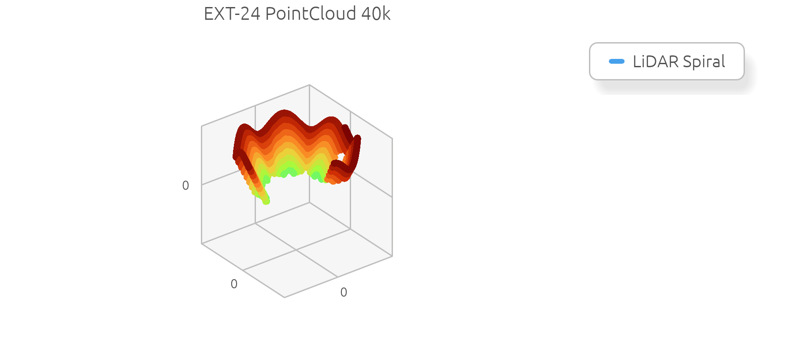](docs/images/point-cloud.png) |
| 位置给出 XYZ 坐标，点的大小和颜色可编码其他测量量。 | 图中是由四万个点组成的螺旋点云，八叉树按视角选取显示细节。 |

| 等值面与封盖 · `--volumes3d` | 直接体绘制 · `--stage16` |
| --- | --- |
| [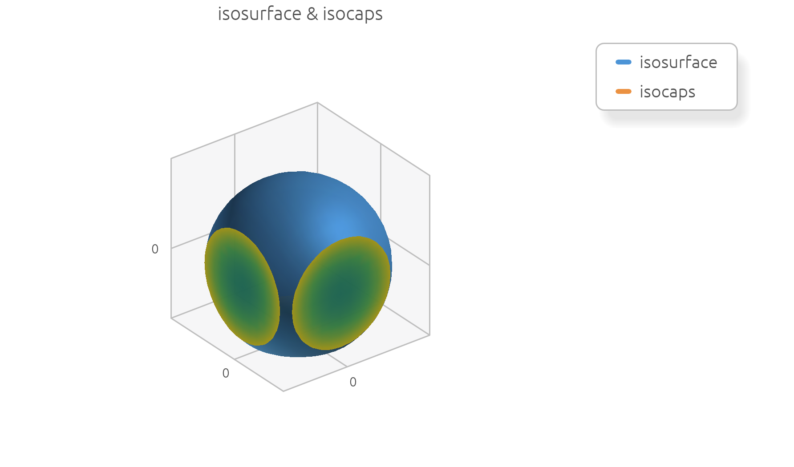](docs/images/isosurface.png) | [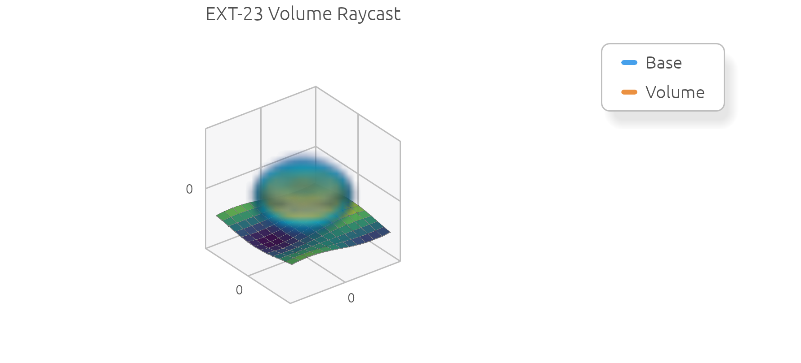](docs/images/volume.png) |
| 用同一标量值的表面观察体数据内部形状。同一画廊还可查看切片、等值切片、四面体和三维流场。 | CPU 光线投射沿视线采样体数据，可切换透明度合成、最大强度投影与等值阈值模式。 |

<a id="gallery-relationships"></a>

### 关系图、标注与动态显示

要跟踪连接关系可看网络图，要比较各条路径承载的量可看桑基图。标注、样式和动画都可在嵌入式画布内体验。

| 分层有向图 · `--networks` | 能源流向 · `--stage16` |
| --- | --- |
| [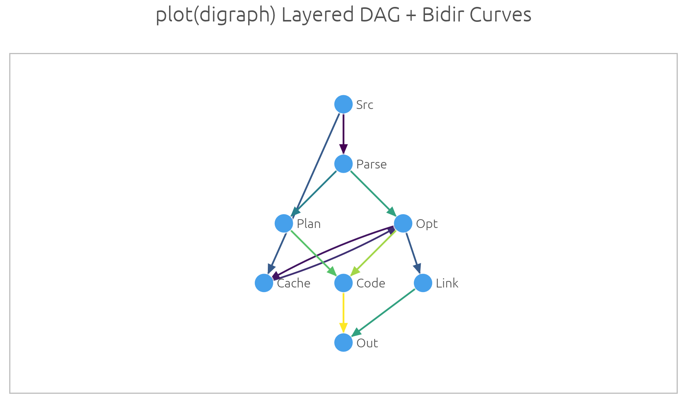](docs/images/network.png) | [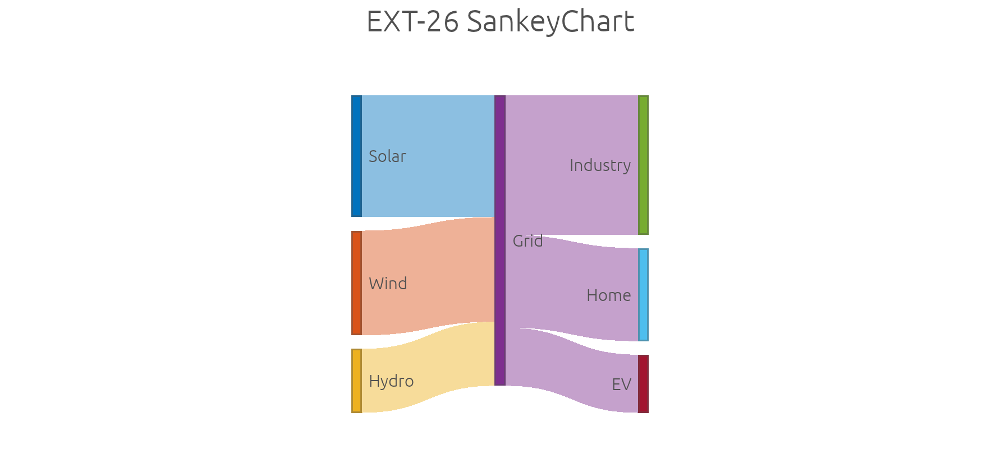](docs/images/sankey.png) |
| 沿有向边追踪节点关系，也可查看力导向布局、树和高亮路径。 | 带宽编码流量。现代图表还包括雷达图、表达层级占比的矩形树图与旭日图，以及表达任务依赖的甘特图。 |

| 峰谷与标注 · `--custom-annotations` | 序列样式 · `--custom-styling` |
| --- | --- |
| [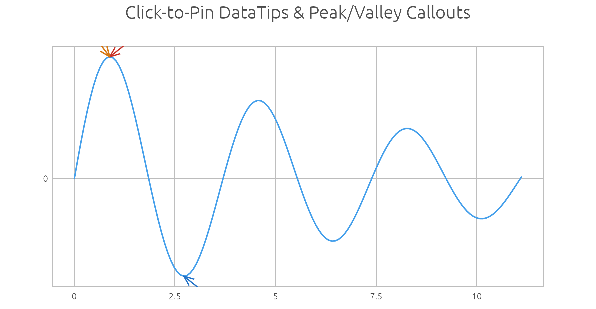](docs/images/annotations.png) | [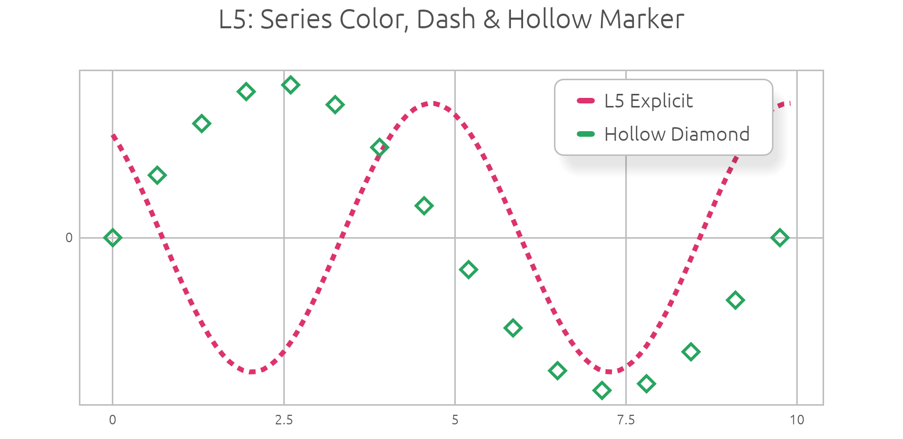](docs/images/styling.png) |
| 标注指向衰减信号的峰谷，点击采样点附近可固定数据提示。 | 用虚线、颜色和空心标记区分序列，单个序列可覆盖所在子图及整幅图的样式。 |

| 彗星轨迹回放 · `--custom-animation` | 甘特排程 · `--stage16` |
| --- | --- |
| [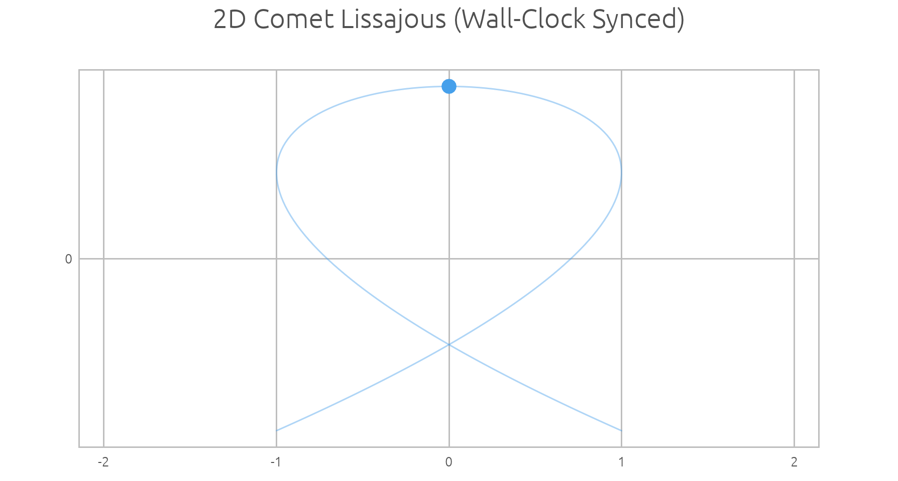](docs/images/animation.png) | [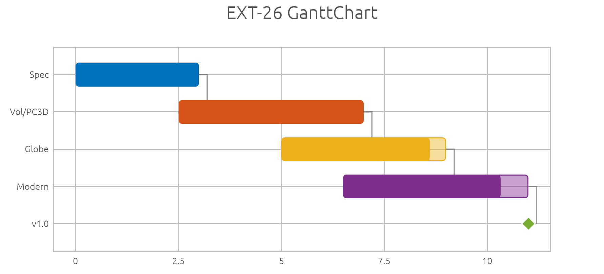](docs/images/gantt.png) |
| 亮点表示利萨如轨迹上的当前位置。演示还可播放记录笔、流式示波器和三维粒子动画。 | 沿水平时间轴比较任务的起点、持续时长与依赖关系。 |

### 完整能力索引

| 绘图用途 | 可展示的内容 | Rust 入口 |
| --- | --- | --- |
| 信号与离散采样 | 连续曲线、阶梯线、针状图、误差棒、分组与堆叠柱形图、堆叠面积图和双 Y 轴。 | `Line`, `Stems`, `ErrorBars`, `Bars`, `Area`, `PlotYy` |
| 标量场与图像 | 显示图像，按数值为规则或曲线网格着色，在填色等高线上标出各级数值。 | `PlotImage`, `Heatmap`, `Pcolor`, `CurvilinearPcolor`, `Contours`, `FilledContours` |
| 函数与平面几何 | 采样显式与隐式曲线，填充带孔多边形，为面片着色，查看三角剖分、Voronoi 单元和稀疏矩阵非零元。 | `FunctionPlot`, `ImplicitCurve`, `PolyShape`, `Patch`, `TriPlot`, `Voronoi`, `AlphaShape`, `Spy` |
| 分布与统计推断 | 查看分箱计数、蜂群、箱线、小提琴和雨云图，用分位数、概率坐标、经验分布和生存曲线分析样本。 | `Histogram2`, `BinScatter`, `SwarmChart`, `BoxChart`, `ViolinPlot`, `Raincloud`, `ProbabilityPlot`, `EcdfPlot` |
| 类别与多变量 | 用饼图和环形图比较占比，用气泡和词云表示权重，通过混淆矩阵定位分类错误，用平行坐标、PCA 双标图和聚类热图查看变量关系。 | `PieChart`, `BubbleChart`, `WordCloud`, `ConfusionChart`, `ParallelPlot`, `Biplot`, `Clustergram` |
| 极坐标、天空与地理坐标 | 绘制方位曲线、角度直方图、罗盘矢量和卫星轨迹，在离线地图上叠加航线、密度和气泡，在地球上显示带高程的轨迹。 | `PolarPlot`, `CompassPlot`, `SkyPlot`, `GeoPlot`, `GeoDensity`, `GeoBubbles`, `GeoGlobePlot` |
| 三维采样与曲面 | 查看空间曲线、气泡、柱形、针状、带状图和点云，用光照与底面等高线辨认曲面起伏，用三角面和四面体展示网格结构。 | `Plot3D`, `PointCloud3D`, `Surface3D`, `MeshSurface3D`, `TriSurf3D`, `TetraMesh3D`, `Patch3D` |
| 体数据与流场 | 用切片、等值面与端盖或光线投射查看体数据，用箭头和锥体表示矢量方向，用流线、流带、流管和粒子跟踪轨迹。 | `VolumeSlice3D`, `Isosurface3D`, `Isocaps3D`, `VolumeRender3D`, `Quiver`, `ConePlot3D`, `Streamlines`, `StreamTube3D` |
| 射频、控制与信号处理 | 读取阻抗或导纳，检查零极点和频率响应，测量单位阶跃响应，用 FFT、Welch 功率谱密度、STFT 和 Morlet 小波分析频率成分。 | `SmithPlot`, `ZPlanePlot`, `BodePlot`, `NyquistPlot`, `NicholsPlot`, `RootLocus`, `StepResponsePlot`, `SpectrogramData`, `CwtPlot` |
| 过程控制与金融 | 用 Nelson 规则识别过程异常，用排列图找出主要贡献项，用 K 线和 OHLC 图查看开高低收，用瀑布图追踪累计变化。 | `ControlChart`, `ParetoChart`, `Candlestick`, `OhlcBars`, `Waterfall2D` |
| 网络、层级与排期 | 追踪网络连边、树的分支和有权重的流向，用雷达图比较多维特征，用矩形树图和旭日图表示层级占比，用甘特图查看工期和依赖。 | `GraphPlot`, `Graph3D`, `DendrogramPlot`, `SankeyChart`, `RadarChart`, `TreemapChart`, `SunburstChart`, `GanttChart` |
| 实时数据与测量 | 显示等间隔或非等间隔采样的数据流，回放运动轨迹，标注点与区间，跨图固定两个游标测量时间差。 | `WaveformLine`, `StreamLine`, `AnimatedLine`, `Comet`, `Annotation`, `SharedCursors` |

各图种共用布局与交互能力。`Figure` 可排列最多 256 个子图，`PlotLayer` 在同一子图叠加序列，`AxisLink` 同步兼容轴，`SharedCursors` 跨图测量。`StackedPlot`、`ScatterHistogram`、`PlotMatrix`、`PlotYy` 和 `ParetoChart` 提供现成的组合布局。`Plot::legend_position` 可在右侧或底部为图例留位，`Plot::color_bar` 为色标标明单位。

**复现配图。** 演示程序用 `PlotSnapshot::render_at` 按每逻辑点 3 像素重新绘制，再将各图表区域导出为 PNG。字体与三维软件深度缓冲按目标密度生成。开启 `export` 特性也可导出混合 SVG。在仓库根目录执行以下命令即可重新生成本页全部配图。

```sh
cargo test -p customplot-demo --locked render_readme_plots -- --ignored
```

---

## 交互式演示程序（`customplot-demo`）

演示程序内置 **27 组互斥画廊**、全局 `PlotDefaults` 控制面板、系统深浅主题实时同步及 PNG/SVG 导出：

```sh
cargo run -p customplot-demo --release --locked
cargo run -p customplot-demo --release --locked -- --dynamic-10m
cargo run -p customplot-demo --release --locked -- --glow --plot3d
```

常用启动参数：

- **渲染后端与基准**：`--glow`（使用 `eframe::Renderer::Glow` 替代默认 `Wgpu`）、`--uncapped`、`--bench-window-10m=<路径.csv>`
- **基础二维与场**：默认二维信号/幂律、`--scalar`、`--statistical`、`--stairs`、`--stems`、`--quiver`、`--polygons`、`--contours`、`--functions`、`--geometry`
- **统计、极坐标与网络**：`--distributions`、`--multivariate`、`--polar`、`--networks`
- **三维、体数据与地理**：`--plot3d`、`--surfaces3d`、`--volumes3d`、`--geo`
- **扩展专题与千万点**：`--stage13`、`--stage14`、`--stage15`、`--stage16`、`--dynamic-10m`
- **客制化专题**：`--custom-axes`、`--custom-annotations`、`--custom-animation`、`--custom-styling`

交互操作：左键拖拽平移；悬停滚轮缩放；右键或 `Shift`+左键框选放大；`Alt`+拖拽刷选数据（`Esc` 清除）；双击或聚焦按 `Home` 复位；三维图中左键轨道旋转、右键平移。

---

## 检查与性能实测

```sh
cargo fmt --all -- --check
cargo test --workspace --locked
cargo test --workspace --all-features --locked
cargo check -p egui-customplot --no-default-features --locked
cargo doc -p egui-customplot --no-deps --no-default-features --locked
cargo doc --workspace --no-deps --all-features --locked
cargo clippy --workspace --all-targets --all-features --locked -- -D warnings
cargo build -p customplot-demo --release --locked
cargo run -p egui-customplot --example export_snapshot --features export --release --locked -- target/exports/example
```

已归档 Windows 实测摘要（历史记录独立保留不覆盖；无头 CPU + tessellation 基准均**不代表** GPU 或 swapchain 帧率，原生窗口结果单列）：

- **无头千万点 CPU + tessellation**（`1920x1080`，[2026-11-16-dynamic-10m-cpu.csv](docs/benchmarks/2026-11-16-dynamic-10m-cpu.csv)）：
  - `uniform_waveform_10m_live_32k`：`total_p95 = 2.1877 ms`（`p50 = 1.9166 ms`）
  - `indexed_stream_10m_live_32k`：`total_p95 = 6.6787 ms`（`p50 = 6.0130 ms`）
  - `plotdata_auto_10m_pan_hover`：`total_p95 = 1.3365 ms`（`pick_p95 = 0.1149 ms`）
  - `scatter_auto_1m_pan`：`total_p95 = 4.8535 ms`
- **深度缩小 1,000 万点 CPU**（`20x`～`10^12x` 动态深缩 + 悬停拾取，[2026-11-16-deep-zoom-out-10m-cpu.csv](docs/benchmarks/2026-11-16-deep-zoom-out-10m-cpu.csv)）：`total_p50 = 0.8311 ms`、`total_p95 = 1.4256 ms`、`pick_p95 = 0.0115 ms`。
- **Windows 原生 `eframe + wgpu` 窗口**（`AMD Radeon RX 7800 XT (Vulkan)`，`AutoNoVsync`，[2026-11-16-dynamic-10m-window-wgpu.csv](docs/benchmarks/2026-11-16-dynamic-10m-window-wgpu.csv)）：
  - `wgpu_10m_waveform_live_32k`：实测 **699.99 FPS**（2,450 帧，`frame_p50 = 1.3124 ms`、`frame_p95 = 1.7540 ms`，每帧仅上传 131,072 B）
  - `cpu_10m_stream_ring_live_32k`（纯 CPU 增量树 + LOD）：实测 **174.13 FPS**（610 帧，`frame_p50 = 5.5789 ms`、`frame_p95 = 6.3164 ms`）
- **Stage 16 三维与现代图 CPU**（`1280x800`，[2026-11-17-stage16-volshow-opt-cpu.csv](docs/benchmarks/2026-11-17-stage16-volshow-opt-cpu.csv) 与 [2026-11-17-stage16-windows-cpu.csv](docs/benchmarks/2026-11-17-stage16-windows-cpu.csv)）：
  - `volshow_64x64x64_direct_alpha`（静态缓存）：`total_p95 = 2.889 ms`（逐帧旋转未命中缓存：`1.893 ms`）；`pcshow_200k_octree_lod_zbuffer`：`0.890 ms`；`geoglobe_wgs84_coastlines_track`：`0.053 ms`；`modern_suite_5charts_figure`：`0.104 ms`。

复跑基准示例（快速试跑可设 `CUSTOMPLOT_BENCH_SECONDS=2`，正式归档保持默认 30 秒）：

```sh
cargo bench -p egui-customplot --bench dynamic_10m_performance --locked
cargo bench -p egui-customplot --bench stage16_performance --locked
```

---

## 项目文档

- [源码组织与域边界](docs/ARCHITECTURE.md)
- [全量实施进度与验证证据](docs/PROGRESS.md)
- [项目规划与分阶段验收](docs/PLAN.md)
- [工程图表设计与验收标准](docs/EXPANSION_PLAN.md)
- [egui 原生集成与性能约束](docs/EGUI_INTEGRATION_AND_PERFORMANCE.md)
- 各阶段详细记录：[1](docs/STAGE_1.md) · [2](docs/STAGE_2.md) · [3](docs/STAGE_3.md) · [4](docs/STAGE_4.md) · [5](docs/STAGE_5.md) · [6](docs/STAGE_6.md) · [7](docs/STAGE_7.md) · [8](docs/STAGE_8.md) · [9](docs/STAGE_9.md) · [10](docs/STAGE_10.md) · [11](docs/STAGE_11.md) · [12](docs/STAGE_12.md) · [13](docs/STAGE_13.md) · [14](docs/STAGE_14.md) · [15](docs/STAGE_15.md) · [16](docs/STAGE_16.md)
- 社区规范：[贡献指南](CONTRIBUTING.md) · [更新日志](CHANGELOG.md) · [安全策略](SECURITY.md)

---

## 参与贡献与许可

欢迎提交 Issue 与 Pull Request，参与前请先阅读 [CONTRIBUTING.md](CONTRIBUTING.md)。

本项目采用与 [`egui`](https://github.com/emilk/egui) 相同的双重许可（`MIT OR Apache-2.0`）：

- Apache License, Version 2.0（见 [LICENSE-APACHE](LICENSE-APACHE)）
- MIT License（见 [LICENSE-MIT](LICENSE-MIT)）

按 Apache-2.0 第 5 条约定，向本仓库提交贡献均默认按上述双重许可提供，不附加额外条款。
